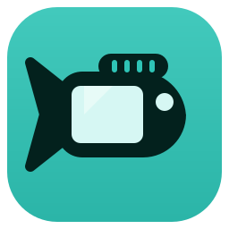
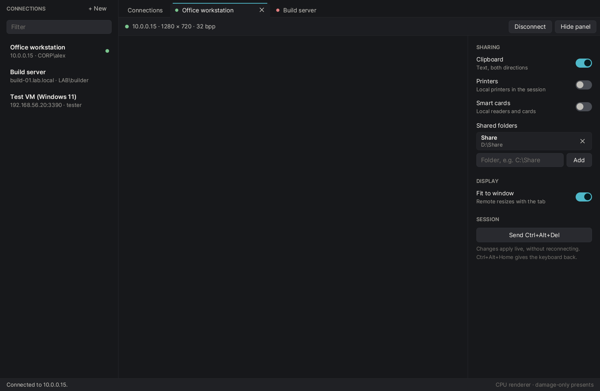

<p align="center"></p>

# rdp-rs

A Remote Desktop Protocol client written from scratch in Rust, from the
Microsoft Open Specifications. No RDP library is used: the connection
sequence, NLA (CredSSP + NTLMv2), the bitmap codecs, virtual channels,
clipboard, drive redirection and live resize are all implemented here, down to
MD4, MD5, HMAC-MD5, RC4 and the ASN.1 DER/BER/PER encodings. Only TLS
([rustls](https://github.com/rustls/rustls)) and SHA-256/randomness
([ring](https://github.com/briansmith/ring)) come from crates.

> **Status: beta ([0.1.0-beta.1](https://github.com/rennerdo30/rdp-rs/releases)).**
> It connects to Windows with NLA and is usable day to day through the bitmap
> path; the graphics pipeline (GFX, H.264) is experimental. Expect rough edges
> and please report them.

## RDP coverage: about 62 %

Of the 38 features a full RDP client offers (below), 22 are done and 3 partly (62 %, counting a partial one as half). That covers the everyday desktop: logon with NLA, the picture, keyboard and mouse, clipboard, drives, printers, smart cards and sound. The missing ones are mostly special cases and enterprise features.

<details>
<summary>Feature list</summary>

| Area | Feature | | Spec |
|---|---|---|---|
| Connection and security | Connection sequence (X.224, MCS, GCC, capabilities, finalization) | ✅ | MS-RDPBCGR |
|  | TLS and NLA (CredSSP with NTLMv2) | ✅ | MS-CSSP, MS-NLMP |
|  | Kerberos authentication | ✅ | MS-KILE via Windows SSPI Negotiate; single sign-on |
|  | Legacy RDP security (RC4, no TLS) | — | MS-RDPBCGR 5.3 |
|  | Licensing | ✅ | MS-RDPELE: 'valid client', new and upgraded licenses with platform challenge; licenses kept in `%LOCALAPPDATA%\rdp-rs\licenses` |
|  | Auto-reconnect and heartbeat | ✅ | MS-RDPBCGR 5.5, 2.2.16 |
|  | Server certificate check | ✅ | trust on first use |
|  | Session broker redirection | ✅ | MS-RDPBCGR 2.2.13: followed while connecting and mid-session |
|  | RD Gateway | ◐ | MS-TSGU: HTTP/WebSocket with NTLM; no RPC over HTTP, no UDP |
|  | UDP transport and multitransport | — | MS-RDPEMT, MS-RDPEUDP |
|  | Network auto-detect | ✅ | MS-RDPBCGR 2.2.14: "Detect automatically" speed; RTT and bandwidth answered, results in the session panel |
| Graphics | Bitmap updates (planar, interleaved RLE) | ✅ | MS-RDPBCGR, MS-RDPEGDI |
|  | Bulk compression (MPPC, NCRUSH, XCRUSH) | ✅ | MS-RDPBCGR 3.1.8, MS-RDPEGDI |
|  | Drawing orders and glyph cache | — | MS-RDPEGDI |
|  | Persistent bitmap cache | — | MS-RDPBCGR 2.2.1.17 |
|  | Graphics pipeline: ZGFX, surfaces, ClearCodec, Progressive | ✅ | MS-RDPEGFX (experimental) |
|  | H.264 AVC420 | ✅ | MS-RDPEGFX 2.2.4.4 |
|  | H.264 AVC444 | ✅ | MS-RDPEGFX 2.2.4.5, 2.2.4.6 (AVC444v2) |
|  | RemoteFX surface bits (RDP 7) | ✅ | MS-RDPRFX, MS-RDPNSC: Set/Stream Surface Bits with RemoteFX and NSCodec, frame acknowledgement |
|  | Pointer shapes | ✅ | MS-RDPBCGR 2.2.9.1.1.4 |
|  | Display Control (resize, scaling) | ✅ | MS-RDPEDISP |
|  | Multiple monitors | ✅ | MS-RDPBCGR 2.2.1.3.6: any chosen monitors, one window each |
| Input | Keyboard and mouse (fast-path) | ✅ | MS-RDPBCGR 2.2.8.1.2 |
|  | Unicode keyboard input | ✅ | touch keyboard, emoji panel, injected text |
|  | Touch and pen | — | MS-RDPEI |
| Device redirection | Clipboard: text and files | ✅ | MS-RDPECLIP |
|  | Drives | ✅ | MS-RDPEFS |
|  | Printers (Easy Print) | ✅ | MS-RDPEPC |
|  | Smart cards | ✅ | MS-RDPESC |
|  | Serial and parallel ports | — | MS-RDPESP |
|  | USB devices | — | MS-RDPEUSB |
|  | Cameras | — | MS-RDPECAM |
|  | Plug and play devices | — | MS-RDPEPNP |
| Audio and video | Audio playback | ✅ | MS-RDPEA: PCM, ADPCM, AAC, MP3 |
|  | Microphone | ✅ | MS-RDPEAI |
|  | Video redirection | — | MS-RDPEVOR, MS-RDPEV |
| Remote apps and collaboration | RemoteApp (seamless windows) | ✅ | MS-RDPERP: apps per connection, one window each, taskbar |
|  | Multiparty and shadowing | — | MS-RDPEMC |

</details>



## Install

Windows: download the setup or the portable zip from
[Releases](https://github.com/rennerdo30/rdp-rs/releases); details in
[docs/INSTALL.md](docs/INSTALL.md). Releases are prepared as described in
[docs/RELEASING.md](docs/RELEASING.md).

## Features

- **Connection:** X.224 negotiation (TLS, NLA, NLA with early user authorization), TLS upgrade, CredSSP v6 with NTLMv2 (MIC, key exchange, sealing, public key binding), MCS/GCC, licensing ("valid client"), capability exchange, finalization, reactivation.
- **Display:** fast-path and slow-path bitmap updates; planar (32 bpp) and interleaved RLE (15/16/24 bpp) codecs; live resize to the window via Display Control over dynamic virtual channels.
- **Input:** fast-path keyboard (scancodes) and mouse (buttons, wheel); Ctrl+Alt+Del button.
- **Sharing, switchable live without reconnecting:** clipboard (Unicode text, both ways), shared folders (drive redirection, confined to the shared folder), printers (Easy Print / XPS, no drivers on the server), smart cards (MS-RDPESC, forwarded to the local WinSCard), sound (MS-RDPEA, PCM).
- **Cursor:** the remote pointer shapes (32/24/16/8/1 bpp, large pointers) as native cursors.
- **Client UI:** one window with a connections sidebar, a tab per session and a control panel per session. Saved connections live in `%APPDATA%\rdp-rs\connections.json`; passwords are never stored.

## Not yet

Kerberos, server certificate validation (the fingerprint is printed), the
graphics pipeline (RDPGFX / H.264), RemoteFX, drawing orders, bulk
compression, audio input (microphone), RD Gateway, UDP transport,
auto-reconnect, RDS licensing (LICENSE_REQUEST), legacy RDP security.

## Layout

| Crate | What |
|---|---|
| [`crates/rdp`](crates/rdp) | Protocol library: connection sequence, session loop, codecs, virtual channels (`cliprdr`, `rdpdr`, `drdynvc`, Display Control). No UI. |
| [`crates/rdpc`](crates/rdpc) | Windows client: connection manager and session tabs, headless PNG screenshot. |
| [`crates/rdpc-update`](crates/rdpc-update) | Update checks: GitHub release discovery, version order, checksums, bounded HTTPS downloads. |

## Build and run

Requires the Rust toolchain pinned in `rust-toolchain.toml` (rustup installs it).

```
# connection manager
cargo run -p rdpc

# one session straight from the command line (password from RDP_PASSWORD or a prompt)
cargo run -p rdpc -- 192.168.1.20 -u DOMAIN\user
cargo run -p rdpc -- 192.168.1.20:3390 -u user -d DOMAIN --size 1600x900

# headless: wait until the screen settles, save a PNG, disconnect
cargo run -p rdpc -- 192.168.1.20 -u DOMAIN\user --screenshot desk.png --wait 15

# protocol trace to stderr (sent PDUs as hex; the Client Info PDU with the password is redacted)
cargo run -p rdpc -- 192.168.1.20 -u DOMAIN\user -v

# render the UI offscreen with sample data
cargo run -p rdpc -- --snapshot-ui ui.png --scale 1.5
```

In `cmd.exe`, write `DOMAIN\user` without quotes (cmd keeps single quotes literally).

Keys: in the Connections tab, Enter connects, Tab moves between fields, Ctrl+N
creates and Ctrl+S saves a connection. Click into a session to send it the
keyboard; Ctrl+Alt+Home gives the keyboard back. Ctrl+Tab switches tabs.

`.cargo/config.example.toml` is the maintainer's optional local setup (shared
sccache, rust-lld, build output outside the repository); plain `cargo build`
needs none of it.

## UI rendering

The client draws its UI on the CPU (winit + softbuffer, with the canvas and
text renderer from [ffwd](https://github.com/rennerdo30/ffwd)). There is no
frame loop and only changed rectangles are presented: UI changes are diffed in
64 × 16 tiles and session updates present just the rectangles the server
updated. That keeps the client cheap when it runs inside a remote session
itself, where GPU rendering would fall back to software.

## Tests

`cargo test` covers the crypto primitives (RFC vectors), NTLMv2 (MS-NLMP 4.2.4
vectors), DER/TSRequest encoding, MCS/GCC/PDU framing, both bitmap codecs,
fast-path reassembly and input, the virtual channel framework, dynamic
channels and Display Control, the clipboard channel (MS-RDPECLIP example
bytes) drive redirection (including path-escape tests), printer and smart card
redirection (NDR encoding) and pointer decoding.

## License

Licensed under either of [Apache License, Version 2.0](LICENSE-APACHE) or
[MIT license](LICENSE-MIT) at your option.

This project is not affiliated with or endorsed by Microsoft. "Remote Desktop
Protocol" is used descriptively; the implementation follows Microsoft's
published Open Specifications.
