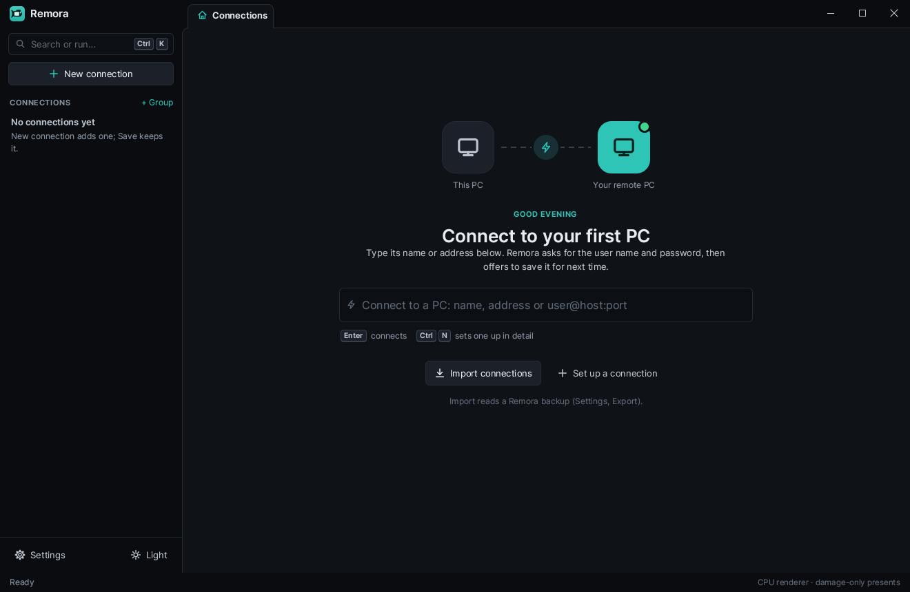
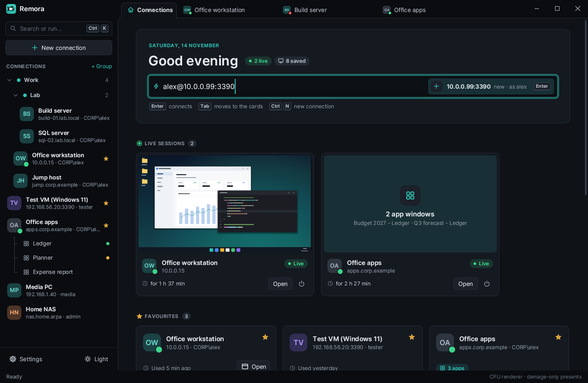
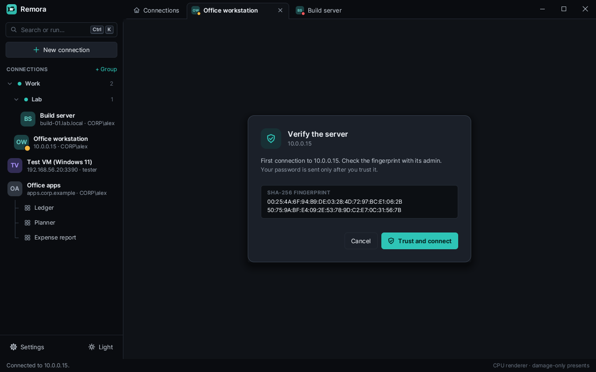
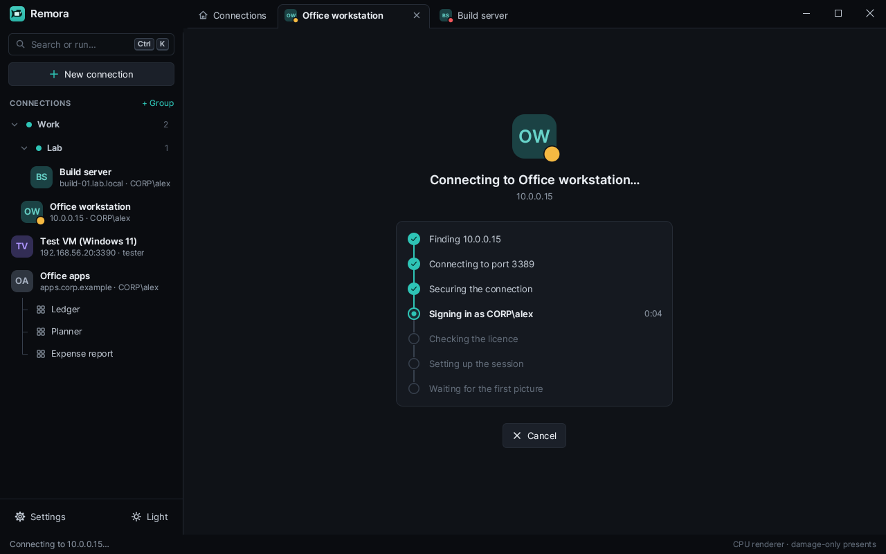
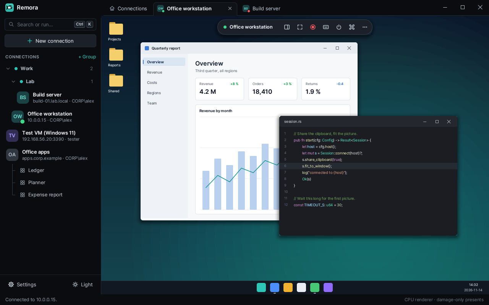
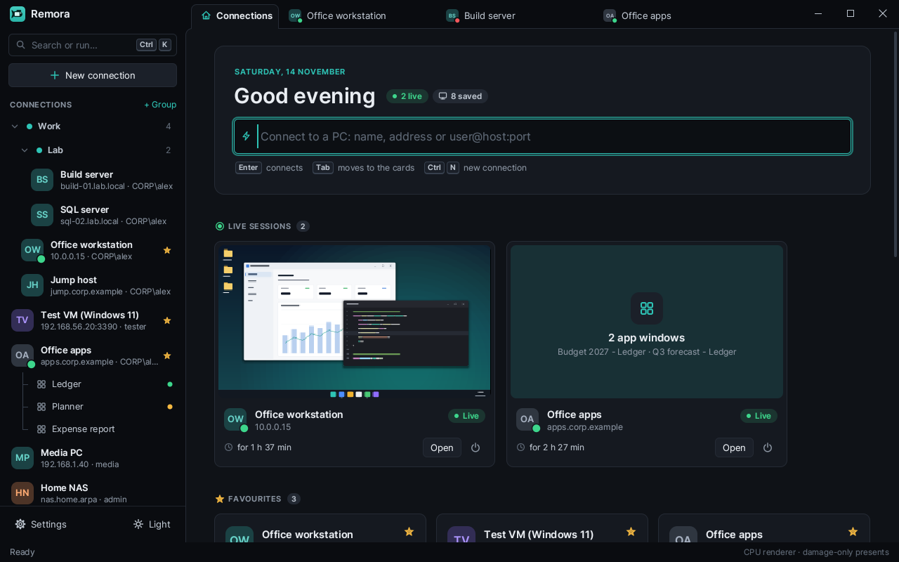
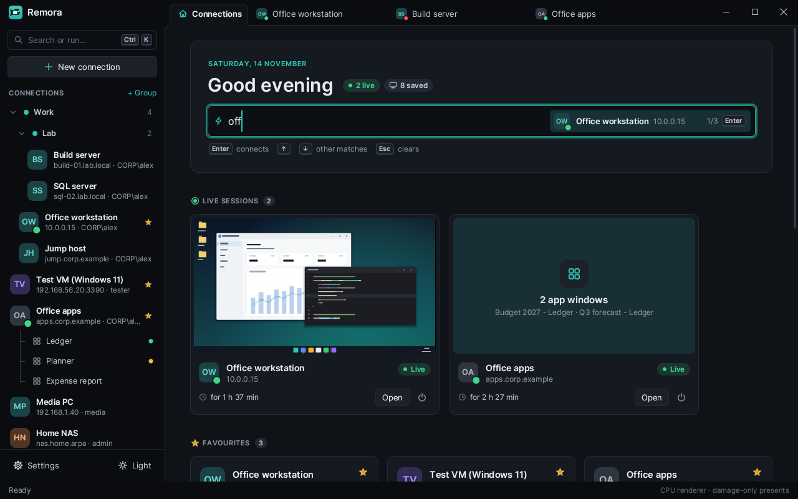
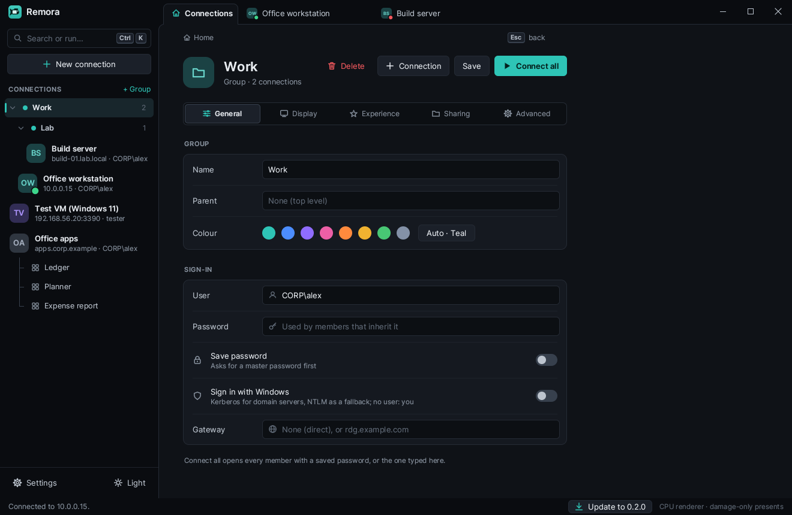

# Getting started with Remora

This page takes you from the download to your first saved connection in a
few minutes. The [user guide](USER-GUIDE.md) covers everything else.

## 1. Install

Download `remora-<version>-setup.exe` from
[Releases](https://github.com/rennerdo30/rdp-rs/releases) and run it.

- It installs for your user only and needs no admin rights.
- It adds a Start menu entry. It does not change PATH or file types.
- The setup is not code-signed yet, so Windows SmartScreen may warn the first
  time. Choose **More info**, then **Run anyway**.

Prefer no installation? Unpack `remora-<version>-windows-x64.zip` anywhere and
run `remora.exe`. [INSTALL.md](INSTALL.md) has the details, including how to
check a download against `SHA256SUMS.txt`.

## 2. Connect to your first PC

The first start shows one field.

1. Type the remote PC's name or address, for example `pc01.corp.example` or
   `10.0.0.15`. Add a port with a colon (`10.0.0.15:3390`) and a user with
   `@` (`alex@10.0.0.15`).
2. Press **Enter**. Remora opens the editor with the address filled in and
   asks for the user name and password.

   

3. Type the user name and password and press **Enter** again. A domain
   account looks like `DOMAIN\name` or `name@domain`.

The remote PC must allow Remote Desktop connections, and your account must be
allowed to sign in remotely.

## 3. Check the server's certificate

The first time you connect to a server, Remora shows its certificate
fingerprint. Your password is sent only after you trust it.

If you can, compare the fingerprint with the one the server's administrator
gives you. Then choose **Trust and connect**. Remora remembers the
certificate and asks again only if it changes.

## 4. Work in the session

Remora shows each connection step while it connects.

Then the remote desktop appears in its own tab.

- **Click into the picture** to send your keyboard to the remote PC.
- **Ctrl+Alt+Home** gives the keyboard back to Remora.
- The toolbar at the top hides while you work. Move the pointer to the top
  edge, or hold **Alt**, to bring it back.
- **Ctrl+Alt+Break** switches full screen on and off.

If the connection fails, Remora says why and what to try. See
[TROUBLESHOOTING.md](TROUBLESHOOTING.md).

## 5. Save the connection

A connection you typed is not kept until you save it. While its session
runs, its card on **Home** has a **Save** button: click it to keep the
connection. Or, before you connect, give it a name in the editor and click
**Save** (or press **Ctrl+S**).

To save the password too, switch on **Save password**. Remora then asks you
to set a master password first: saved passwords are kept only in an encrypted
vault. Without a master password, Remora never writes a password to disk. See
[SECURITY.md](SECURITY.md).

## 6. Connect again later

Saved connections show on **Home** and in the sidebar.

- Type a few letters of a saved connection into the field at the top, then
  press **Enter**. **Up** and **Down** pick another match.
- Or click a connection in the sidebar to open it in the editor, then click
  **Connect** or press **Enter**.
- Click the star in the editor to pin a connection to **Favourites**.
- If a session of that connection already runs, Remora shows it instead of
  opening a second one.

## 7. Put connections in groups

Groups keep the sidebar tidy and share settings.

- Click **+ Group** in the sidebar to make one, or type a group into a
  connection's **Group** field. Use `/` for groups inside groups, for example
  `Work/Servers`.
- A group has a colour, and can hold a user name, password, gateway, display
  settings and sharing.
- In a connection inside a group, switch on **Use the group's sign-in** (or
  display settings, or sharing) to take that part from the group. Change it
  once in the group, and every connection that uses it follows.
- **Connect all** on a group opens every connection in it that has a saved
  password, or uses the password typed into the group.

## Next

- [User guide](USER-GUIDE.md): every screen and setting.
- [Keyboard shortcuts](SHORTCUTS.md).
- [Troubleshooting](TROUBLESHOOTING.md) when a connection fails.
- [Security and privacy](SECURITY.md): what is stored where.
