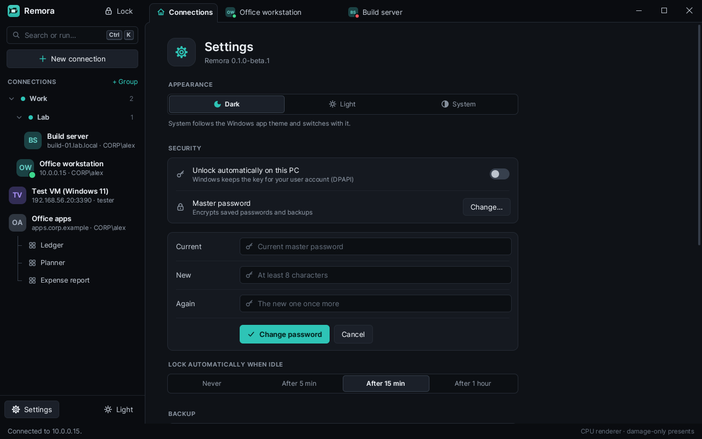
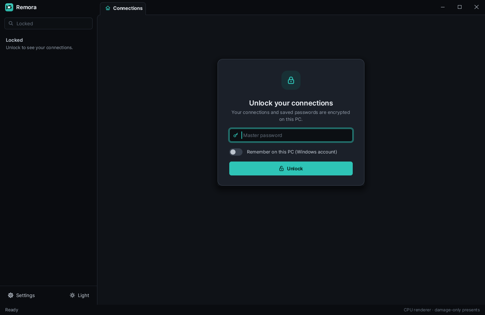
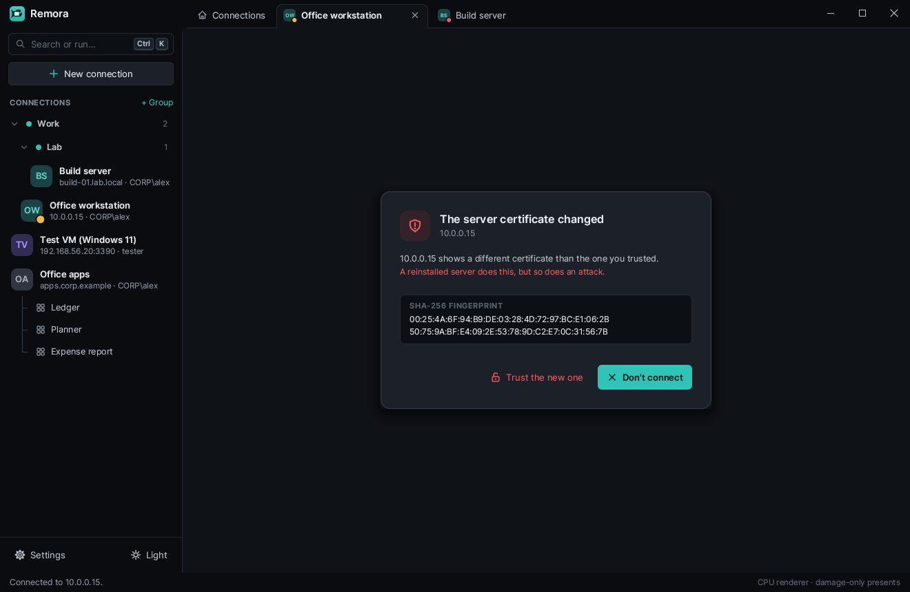

# Security and privacy

What Remora stores, how it protects your passwords, how it checks servers,
and what it never does.

## In short

- No account, no telemetry. Remora talks to your servers (and gateways) and,
  from an installed copy, to GitHub once a day for updates. Nothing else.
- Passwords are saved only in an encrypted vault, and only after you set a
  master password. Without one, no password is ever written to disk.
- A server's certificate is checked before your password is sent.
- Sharing (clipboard, folders, printers, smart cards, sound, microphone) is off
  until you switch it on.
- Logs never contain passwords.

## What is stored where

| Where | What | Secret? |
|---|---|---|
| `%APPDATA%\rdp-rs\connections.json` | Saved connections and groups, when you have no master password. Never a password. | No |
| `%APPDATA%\rdp-rs\vault.bin` | Saved connections, groups and passwords, when you have a master password. Encrypted. | Encrypted |
| `%APPDATA%\rdp-rs\vault.key` | Only with **Unlock automatically on this PC**: the vault key, protected by Windows for your user account. | Protected |
| `%APPDATA%\rdp-rs\settings.json` | App settings: theme, auto-lock, updates, diagnostic log. | No |
| `%APPDATA%\rdp-rs\known_hosts.json` | Servers whose certificate you trusted, as SHA-256 fingerprints. | No |
| `%LOCALAPPDATA%\rdp-rs\licenses` | Remote Desktop client licences that servers issued to this PC. | No |
| `%LOCALAPPDATA%\rdp-rs\bitmap-cache` | Pieces of remote screens the server asked to cache, per server, up to 100 MB. | Screen content |
| `%LOCALAPPDATA%\rdp-rs\logs\remora.log` | The diagnostic log, only while it is switched on. | No passwords |
| `Videos\Remora` | Your session recordings (MP4), only when you record. | Screen content |

Uninstalling Remora leaves your connections in `%APPDATA%\rdp-rs`. Delete the
two `rdp-rs` folders to remove everything.

## The vault

Remora saves passwords only in the vault. You create it by setting a master
password (at least 8 characters): in **Settings**, under **Security**, or
when you first switch on **Save password** for a connection.

- **Encryption.** The key comes from your master password through Argon2id
  (64 MiB of memory, 3 passes, a random salt). The file is encrypted with
  XChaCha20-Poly1305. The file's header is authenticated too, so any change
  to the file makes it fail to open. A wrong password and a damaged file
  fail the same way; nothing half-decrypted is ever used.
- **Moving in.** Creating the vault moves your connections into it.
  `connections.json` is removed only after the vault was written and read
  back successfully.
- **Locking.** The vault locks after a time without use: 15 minutes by
  default, or 5 minutes, 1 hour or never (Settings, **Lock automatically
  when idle**). **Lock** at the top of the sidebar, or **Lock vault** in the
  command palette, locks it at once. While it is locked, Remora shows no
  connections until you type the master password.

  

- **Unlock automatically on this PC.** With this switch on, Windows keeps
  the vault key for your Windows account (DPAPI), so Remora opens the vault
  without asking. Anyone signed in as you on this PC can then open it. The
  vault file alone, copied elsewhere, still needs the master password.
- **Changing the master password** encrypts the vault again with a new salt.
- **Forgotten master password.** Remora cannot recover it: without it, the
  vault cannot be decrypted.
- **Backups.** **Export** (Settings, **Backup**) writes one file
  (`.rdpbackup`) encrypted the same way, with your master password. **Import**
  asks for the backup's master password and adds its connections and groups.
- In memory, keys and decrypted data are wiped when they are no longer
  needed.

## Server certificates

Remora uses trust on first use, like SSH:

- The first connection to a server shows its certificate's SHA-256
  fingerprint. Your password is sent only after you choose **Trust and
  connect**. If you can, compare the fingerprint with one from the server's
  administrator.
- Later connections with the same certificate connect without asking.
- If the certificate changes, Remora stops and warns you before anything is
  sent. Servers renew certificates now and then, but a change you do not
  expect can also mean someone is in between. Ask the administrator before
  you accept it.

The same check covers an RD Gateway's certificate. Trusted fingerprints live
in `known_hosts.json`; to forget a server, remove its entry there while Remora
is closed.

## Signing in

Remora uses Network Level Authentication (NLA): you sign in before the server
starts a session for you.

- **Remora's own sign-in** is CredSSP with NTLMv2, written from Microsoft's
  specifications. It binds the sign-in to the server's TLS key, so the
  credentials go only to the server whose certificate was checked.
- **Sign in with Windows** (a switch in the connection's sign-in) uses
  Windows' own Negotiate: Kerberos on a domain, NTLM as a fallback. With no
  user name, it signs in as you, with your Windows session (single sign-on);
  Remora never sees a password then.
- TLS comes from [rustls](https://github.com/rustls/rustls). Remora does not
  offer the old RDP security without TLS.

## Sharing

Every kind of sharing is off for a new connection. You switch it on per
connection, per group, or live in a running session, and it applies only to
that session.

- **Shared folders** appear in the session as drives. The server can reach
  only what is inside the folder you shared: paths that try to leave it,
  through `..`, links, other drive letters or device names, are refused.
- **Clipboard** sharing works both ways, for text and files, while it is on.
- **Printers, smart cards, sound and the microphone** reach the session only
  while their switch is on.

## Logs and what is never logged

- The diagnostic log is off unless you switch it on (Settings,
  **Troubleshooting**). It is local and written again at each start.
- Passwords are never logged. The packet carrying the password, licensing
  packets and the password blob of a server redirect are shown as
  `[redacted]`, also in the command line's `-v` trace.
- The log does contain server names, user names and protocol details. Read
  it before you share it.

## Updates

An installed copy asks
`https://api.github.com/repos/rennerdo30/rdp-rs/releases` once a day whether
a newer release exists (Settings, **Updates**, turns it off). It downloads
only from this repository's GitHub releases, and checks the setup against
the release's `SHA256SUMS.txt` before running it. Portable copies never
check. See the [privacy page](https://remora.renner.dev/privacy.html) for the
website.

## Reporting a security problem

Please write to [support@renner.dev](mailto:support@renner.dev) instead of
opening a public issue.
