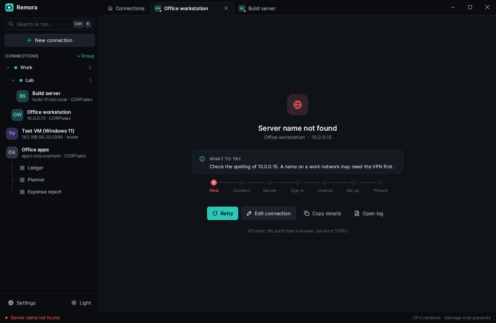
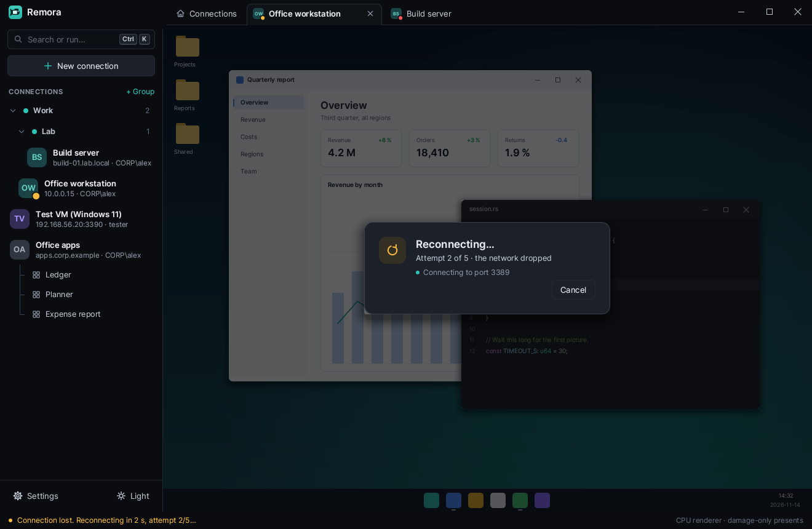
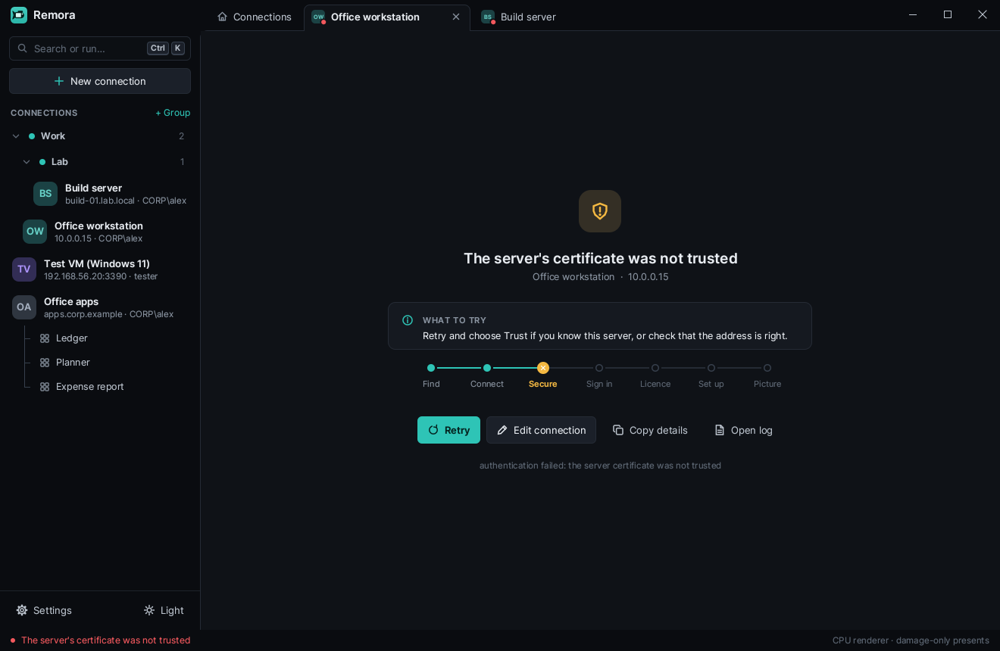
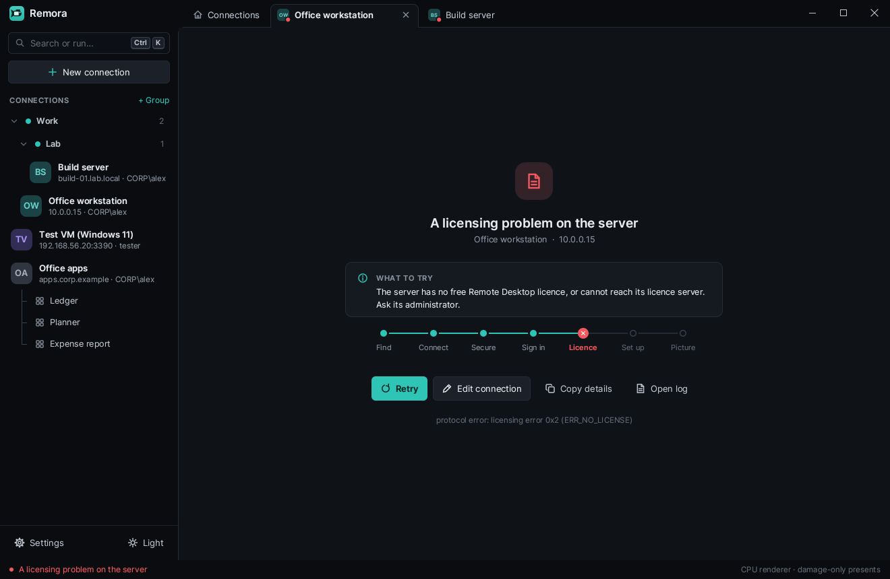
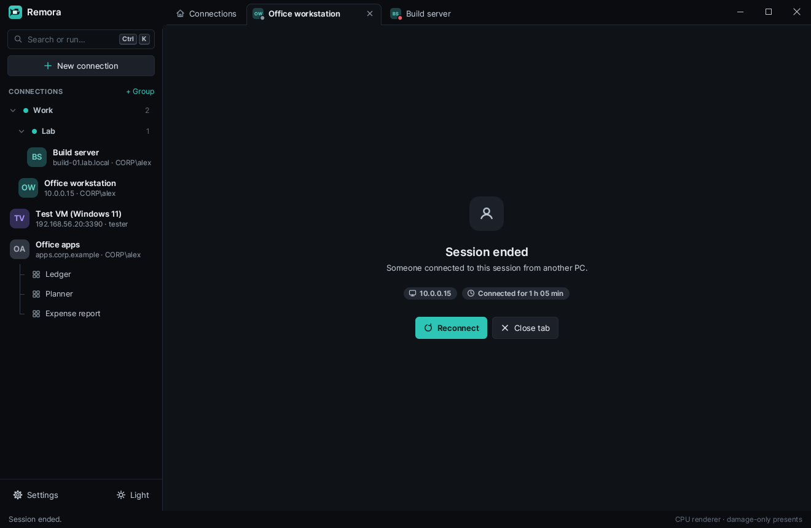

# Troubleshooting

When a connection fails, the session tab shows what went wrong in plain words,
a suggestion that names your server, port and user, the connection step where
it stopped, and four buttons:

- **Retry** tries again.
- **Edit connection** opens the connection in the editor.
- **Copy details** copies the technical details of the failure, for a
  search or a bug report.
- **Open log** opens the diagnostic log (see [The diagnostic log](#the-diagnostic-log)).

The sections below follow the titles on that screen.

## Finding the server

### Server name not found

The name does not resolve to an address. Check its spelling. A name on a work
network often resolves only while the VPN is connected. Try the IP address
instead to rule out DNS.

### The server refused the connection

The PC answered, but nothing listens on the port. Remote Desktop may be off
on that PC (Settings, System, Remote Desktop), the port may be wrong (3389 is
the default), or a firewall blocks it.

### The server did not answer

No answer came in time. The PC may be asleep or off, or a firewall silently
drops the port. Wake the PC and try again.

### The server cannot be reached

This PC has no route to the server. Check this PC's network connection and
VPN.

### The connection was lost

A running session lost the network, and the automatic reconnect did not get
it back. Check the network, then click **Retry**.

When the network drops, Remora first tries on its own: up to five times,
after 1, 2, 4, 8 and 15 seconds, over the last picture. **Cancel** on that card
stops it.

## Signing in

### Wrong user name or password

Check the user name and the password. Domain accounts look like
`DOMAIN\name` or `name@domain`. If the connection takes its sign-in from a
group, check the group's.

### This account is locked

Too many failed sign-ins locked it. Wait for the lock to expire, or ask an
administrator to unlock it.

### This account is disabled / This account has expired

Ask an administrator of the domain to enable the account again.

### The password has expired

Change the password on a PC in that domain (or wherever your organisation
lets you), then sign in here with the new one.

### Not allowed to sign in remotely

The account is valid but may not use Remote Desktop on that server. Add it to
the **Remote Desktop Users** group on the server, or ask its administrator
about the sign-in policy (logon hours, allowed computers).

### The server asks for the password again

This server does not accept saved credentials. Type the password again.

## Security

### The server's certificate was not trusted

You chose **Cancel** on the certificate question, or the certificate changed
and you did not accept the new one. If you know the server, click **Retry**
and choose **Trust and connect**. If the certificate changed unexpectedly,
check that the address is right and ask the server's administrator first: a
changed certificate can also mean someone is in between. See
[SECURITY.md](SECURITY.md#server-certificates).

### The secure connection failed

The TLS handshake did not finish. The server may need other security
settings, or something on the network interferes with the connection.

### This server only offers legacy, weak security

The server has no TLS: it is set to the old "RDP Security Layer" (Standard
RDP Security, RC4). The best fix is on the server: let it use TLS (on
Windows, the Remote Desktop security layer "Negotiate" or "SSL"). If you
cannot change it and trust the network, edit the connection and turn on
**Allow legacy RDP security (weak)** under **Advanced**; this also covers
servers set to the FIPS encryption level. See
[SECURITY.md](SECURITY.md#legacy-rdp-security).

## RD Gateway

### The RD Gateway refused the sign-in

Check the credentials for the gateway (Remora uses the connection's user name
and password), and that the gateway's policy lets you reach this server.

### The RD Gateway cannot be reached

Check the gateway address in the connection's **Gateway** field and this PC's
network. Remora connects to gateways over HTTPS: the HTTP transport (over a
WebSocket) first, and RPC over HTTP when the gateway does not offer HTTP.
Turn on **Gateway over RPC** for a gateway that should only be reached over
RPC over HTTP.

The message names the step that failed:

- **RPC OUT channel** or **RPC IN channel**: the gateway's
  `/rpc/rpcproxy.dll` did not take the request. HTTP 404 means the gateway
  does not offer RPC over HTTP either; "rejected the credentials" means the
  user name or password.
- **RPC virtual connection** or **RPC bind**: the gateway's RPC proxy did not
  reach its own RPC service (port 3388 on the gateway).
- **TsProxyCreateTunnel**, **TsProxyAuthorizeTunnel**: the gateway's
  connection policy (RD CAP) refused the user.
- **TsProxyCreateChannel**: the gateway's resource policy (RD RAP) refused
  the server, or the gateway could not reach it.

A session through RPC over HTTP ends after about 1 GB in either direction
(Remora does not renew the gateway's RPC channels); it then reconnects on
its own.

### The RD Gateway could not reach the server

The gateway answered but could not open the server. The server may be off,
or the gateway's policy blocks it.

## The server itself

### A licensing problem on the server

The server has no free Remote Desktop licence, or cannot reach its licence
server. Only its administrator can fix this.

### The server turned the connection down

The server, or a connection broker in front of it, is not taking connections
right now. Try again later, or ask its administrator.

### This server needs a feature Remora lacks

**Copy details** shows which feature. Please report it; the
[README](../README.md#rdp-coverage-about-78-) lists what Remora supports.

### Unexpected answer from the server

This is most likely a bug in Remora (or the server). Copy the details, turn
on the diagnostic log, reproduce it, and [report it](#reporting-a-bug).

### Could not connect

No more specific cause was found. **Copy details** has the technical text.

## Shadowing

These are the messages of `remora <server> --shadow ID` and `--list-sessions`.

| Message | What to do |
|---|---|
| … is not reachable over SMB (TCP 445) … (RPC status 1722) | Remora requests the invitation over File and Printer Sharing. Allow **File and Printer Sharing (SMB-In)** on the server, and check the name. |
| access denied by …: shadowing needs an administrator there | Sign in to this PC as an administrator of the server. `runas /netonly` also works. |
| … refused to shadow session N: the user declined the request | The session's user clicked **No**, or did not answer within about 30 seconds. |
| … policy requires the user's permission / allows view-only shadowing | The server's group policy **Set rules for remote control of Remote Desktop Services user sessions** forbids what you asked for. Leave out `--no-consent-prompt` or `--control`, or change the policy. |
| … shadowing is disabled by policy on the server | The same policy turns remote control off. |
| another shadow session already controls this session | Only one viewer can control a session at a time. Watch, or try again later. |
| The connection to the shared desktop times out | Enable the firewall rule **Remote Desktop - Shadow (TCP-In)** on the server. The shadow connection uses a new port each time. |
| the shared desktop only offers Standard RDP Security (no TLS) | This sharer offers only the old RDP encryption, which Remora does not implement. [Report it](#reporting-a-bug) with the diagnostic log. |
| server refused negotiation: … | The sharer wanted another security protocol. Try again with `--preconnection`, then report it. |

## When a session ends

A session that ends without an error shows why and how long it ran, with
**Reconnect** and **Close tab**.

| Message | What happened |
|---|---|
| You disconnected. | You chose Disconnect in Remora. |
| You signed out of the remote PC. | You signed out inside the session. |
| You disconnected from inside the session; it keeps running there. | You chose Disconnect in the remote Start menu. **Reconnect** gets it back. |
| An administrator disconnected the session. / An administrator signed you out. | Someone with rights on the server ended it. |
| Someone connected to this session from another PC. | The same account connected from elsewhere and took the session over. |
| The server disconnected the idle session. | The server's idle limit ran out. |
| The sign-in took too long, so the server ended it. | The logon screen waited too long. |
| You cancelled reconnecting. | You clicked Cancel while Remora reconnected. |
| The server ended the session. | The server gave no reason. |

## Other problems

- **Keys type the wrong characters.** Your keyboard layout and the session's
  differ. The side panel's Session page (or the editor's Experience page) has
  three keyboard modes; **Automatic** is right for most people, **Translate**
  always sends text as you type it here. See the
  [user guide](USER-GUIDE.md#keyboard).
- **Alt+Tab or the Windows key work on this PC instead of the session.** That
  is the **Windows keys** setting: by default they go to the session only in
  full screen.
- **A change of quality did nothing.** Quality settings apply at logon. The
  Quality page offers **Reconnect now**.
- **The picture looks wrong with GFX (H.264).** The graphics pipeline is
  experimental. Switch the connection back to **Bitmaps** on the editor's
  Advanced page, and please report it.
- **A shared COM or LPT port does not show in the session, or cannot be
  opened there.** The port must be on this PC when you switch it on (the
  message says so otherwise). The server must allow port redirection: its
  Remote Desktop Session Host policies "Do not allow COM port redirection"
  and "Do not allow LPT port redirection" must not be enabled. A program on this PC that has the port open blocks it for the
  session: the session's program then gets "access denied". Some servers
  keep showing a port after you switch it off; it no longer works there
  and goes away at the next connection.
- **A shared camera does not appear in the session.** Camera redirection
  needs Windows 10 version 1803, Windows Server 2019 or later on the server,
  and the server's policy "Do not allow video capture redirection" (Remote
  Desktop Session Host, Device and Resource Redirection) must not be
  enabled. Check that **Camera** is on in the side panel and that the camera
  was plugged in when the session started (otherwise reconnect).
  `remora --list-cameras` shows the cameras Remora sees, without opening
  them. A camera another app on this PC is using may refuse to start.
- **A video plays in the wrong place, flickers or freezes with video
  redirection.** Switch **Video redirection** off on the editor's Advanced
  page (or the side panel's Quality page) and reconnect: the server then
  sends the video inside the desktop picture again. The diagnostic log shows
  the video presentations (`video N: start ...`) and their geometry
  (`geometry ...`); please attach it to the report.
- **The statistics say "TCP · UDP failed" or "UDP offered, not used".** The
  UDP transport (editor's Advanced page) could not be used; the session runs
  normally over TCP. Common causes:
  - A firewall drops **UDP port 3389** (or the connection's port) on the way
    to the server or on the server itself. Windows' rule is "Remote Desktop -
    User Mode (UDP-In)"; it must be allowed for the profile of the server's
    network. TCP 3389 being open is not enough.
  - The server has UDP switched off: the policy "Select RDP transport
    protocols" (Computer Configuration, Administrative Templates, Windows
    Components, Remote Desktop Services, Remote Desktop Session Host,
    Connections) set to **Use only TCP**.
  - A port forwarding or NAT that forwards only TCP. Forward UDP to the
    same port too.
  - The server presented a different certificate on UDP than on TCP; Remora
    then refuses UDP on purpose.

  The diagnostic log names the reason in its "UDP tunnel failed" line. When
  UDP breaks during a session that already uses it, Remora reconnects that
  tab (resuming the same Windows session) and keeps it on TCP.
- **Windows warns when starting the setup.** The setup is not code-signed yet.
  Choose **More info**, then **Run anyway**.

## The diagnostic log

The diagnostic log records protocol details of every connection. It is off
unless you turn it on.

1. Open **Settings** (bottom of the sidebar), go to **Troubleshooting**, and
   switch on **Diagnostic log**.
2. Reproduce the problem.
3. Click **Log folder** in Settings, or **Open log** on the error screen.

The log is `%LOCALAPPDATA%\rdp-rs\logs\remora.log`. It is written again from
the start each time Remora starts, so copy it before you restart.

The log never contains passwords. It does contain server names, user names
and protocol details, so read it before you share it.

## Reporting a bug

Open an issue at
[github.com/rennerdo30/rdp-rs/issues](https://github.com/rennerdo30/rdp-rs/issues)
with:

- the Remora version (Settings shows it under Updates, and
  `remora.exe --version` prints it);
- your Windows version, and what the server is (Windows version, RD Session
  Host, gateway);
- what you did and what happened, with **Copy details** from the error screen;
- the diagnostic log if you can, with anything private removed.

Nothing is sent automatically: a log reaches us only if you attach it.
