# Remora user guide

Every screen and setting of Remora, the Remote Desktop client. New to it?
Start with [Getting started](GETTING-STARTED.md).

- [The window](#the-window)
- [Home](#home)
- [Connections and the editor](#connections-and-the-editor)
- [Groups](#groups)
- [Sessions](#sessions)
- [Sharing](#sharing)
- [Server helper](#server-helper)
- [Monitors and full screen](#monitors-and-full-screen)
- [RemoteApp](#remoteapp)
- [Recording](#recording)
- [Keyboard](#keyboard)
- [The command palette](#the-command-palette)
- [Themes](#themes)
- [The vault](#the-vault)
- [Backup and import](#backup-and-import)
- [Updates](#updates)
- [The command line](#the-command-line)

## The window

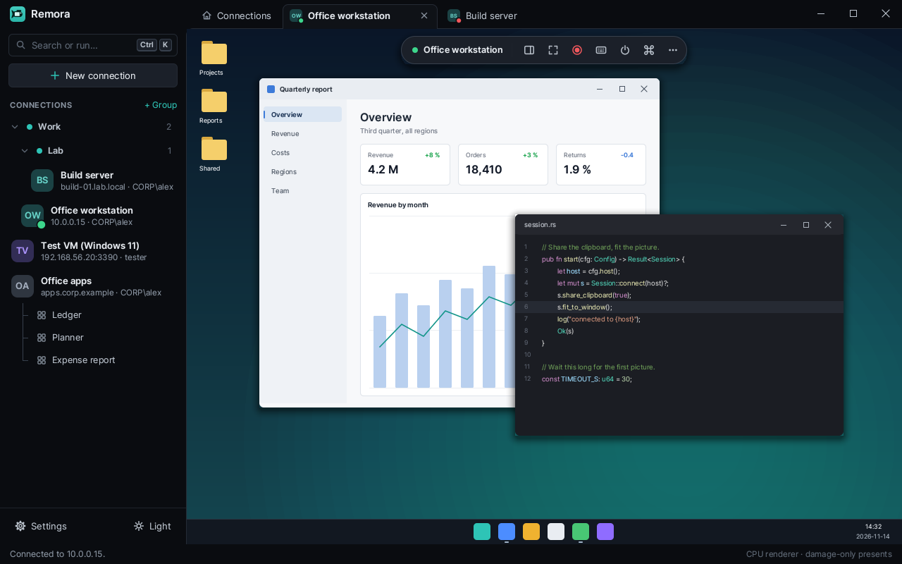

- **The sidebar** on the left lists your connections in their groups, with a
  dot for each running session. At its top are the search field (click it,
  or press **Ctrl+K**, for the command palette; **Ctrl+F** filters the list)
  and **New connection**. At the bottom are **Settings** and a switch between
  the dark and light theme.
  - **Fold it to a rail**: the menu button (three bars) at its top left, or
    **Ctrl+B**, or **Collapse sidebar** in the command palette. The rail keeps
    Home, search, **New connection**, Settings and the theme as icons, and
    shows each connection as its initials with its live dot; point at one for
    its name, address and apps, click it to open it. Connections that do not
    fit become a **+N** button that unfolds the sidebar. The same button or
    **Ctrl+B** unfolds it; **Ctrl+F** unfolds it to filter.
  - **Resize it**: drag its right edge (the pointer turns into a resize
    arrow), from 200 to 480 px wide. Dragging it narrower than that folds it
    to the rail; dragging the rail's edge out unfolds it. A double-click on
    the edge puts the default width back. Remora remembers the width and
    whether the sidebar is folded.
- **The tabs** at the top: **Connections** (Home, the editor and Settings),
  then one tab per session. **Ctrl+Tab** and **Ctrl+Shift+Tab** switch
  between them.
- **The status bar** at the bottom says what just happened, and shows an
  **Update** button when a new version is ready.

## Home

Home is the first page of the Connections tab.

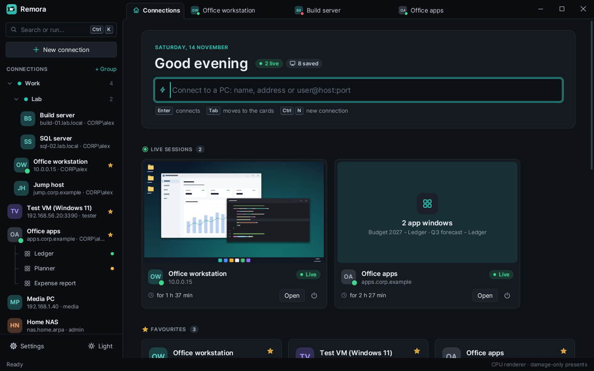

- **Quick connect** at the top takes a saved connection's name (a few letters
  are enough), a computer name or address, or `user@host:port`. **Up** and
  **Down** pick a match; **Enter** connects. If a session of that connection
  already runs, Remora shows it instead of opening a second one. A new
  address opens the editor to ask for the sign-in.
- **Live sessions** show a thumbnail of each running desktop, updated while
  Home is open, and how long the session has run. **Open** shows it; the
  power button disconnects it. A session you started without saving its
  connection has a **Save** button here.
- **Favourites** are the connections you pinned with the star in the editor.
  **Recent** lists the ones you used last, newest first.

**Tab** walks from the field through the cards; **Enter** opens the one
in focus.

## Connections and the editor

Click a connection in the sidebar to open it in the editor, or press
**Ctrl+N** for a new one. **Save** (**Ctrl+S**) keeps your changes;
**Connect** (**Enter**) starts a session with what the form shows, saved or
not. **Esc** goes back to Home. The star pins the connection to Favourites;
**Delete** removes it.

On a wide window, a **Summary** column next to the form says in plain words
what Connect will do, and which group each inherited part comes from.

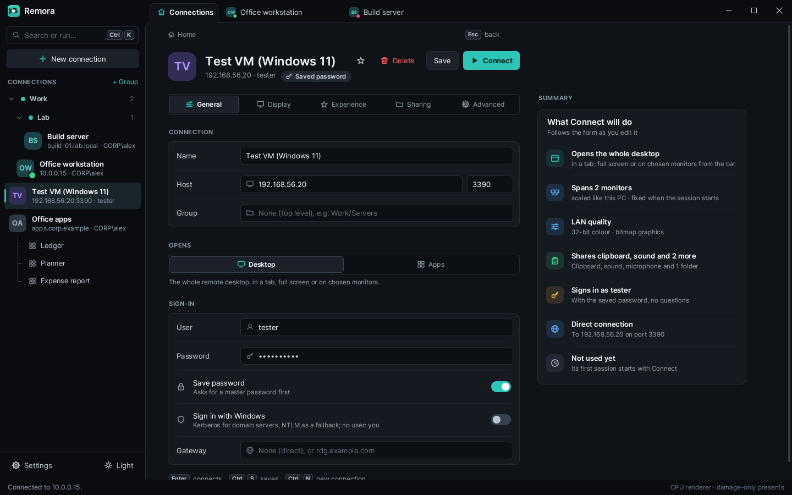

The editor has five pages.

### General

- **Name**, **Host** and port (3389 unless the server uses another), and
  **Group** (for example `Work/Servers`; empty for the top level).
- **Opens**: what **Connect** (and **Enter**) starts: **Desktop** (the
  default) for the whole remote desktop, or **Apps** for the first of the
  connection's programs in its own window (see [RemoteApp](#remoteapp)).
- **Apps**: the connection's RemoteApp programs. They are listed under the
  connection in the sidebar whatever it opens, and each one starts on its
  own.
- **Sign-in**: **User** (`name`, `DOMAIN\name` or `name@domain`) and
  **Password**.
  - **Save password** keeps the password in the encrypted vault. It asks you
    to set a master password first.
  - **Sign in with Windows** uses Windows' own sign-in: Kerberos for domain
    servers, NTLM as a fallback. With no user name, it signs in as you.
  - **Gateway**: an RD Gateway as `host` or `host:port`, or empty for a
    direct connection. The gateway gets the same user name and password.

### Display

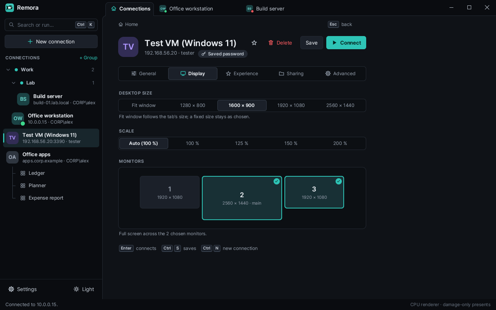

- **Desktop size**: **Fit window** (the remote desktop follows the tab's
  size) or a fixed 1280 × 800, 1600 × 900, 1920 × 1080 or 2560 × 1440.
- **Scale**: **Auto** follows this PC's Windows scaling; or 100, 125, 150 or
  200 %.
- **Monitors**: click monitors on the map to use them; see
  [Monitors and full screen](#monitors-and-full-screen).

### Experience

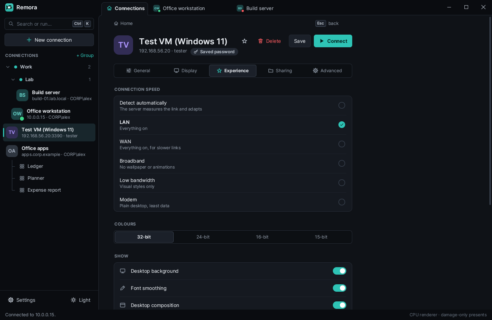

- **Connection speed**: **Detect automatically** (the server measures the
  link and adapts), or a preset from **LAN** to **Modem**. Each preset sets
  the switches below the way Windows' own client does.
- **Colours**: 32, 24, 16 or 15-bit.
- **Show**: desktop background, font smoothing, desktop composition, window
  contents while dragging, menu and window animations, visual styles.
- **Input**: **Touch and pen** sends touch and pen (with pressure and tilt)
  to the session when the server supports it; off, they act as the mouse.
- **Keyboard**: see [Keyboard](#keyboard).

### Sharing

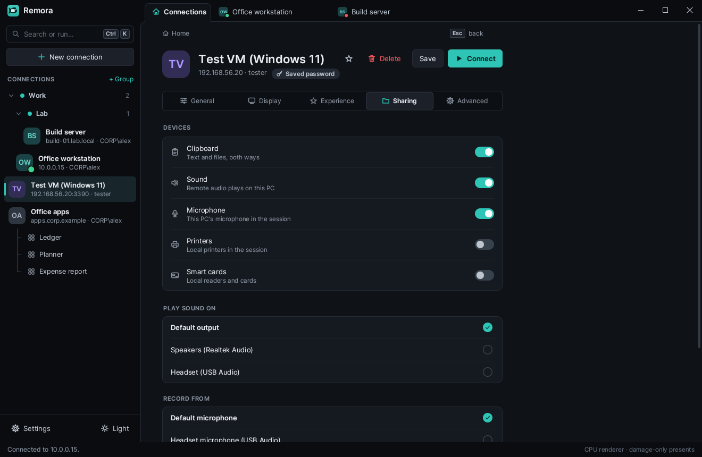

What the session may use from this PC, from the moment it starts. See
[Sharing](#sharing). The **Server helper** switches at the bottom are
explained in [Server helper](#server-helper).

### Advanced

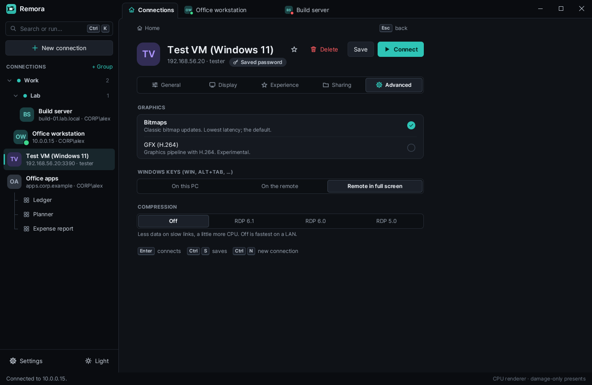

- **Graphics**: **Bitmaps**, classic bitmap updates with the lowest latency
  (the default), or **GFX (H.264)**, the graphics pipeline with H.264
  (experimental).
- **Windows keys (Win, Alt+Tab, …)**: **On this PC**, **On the remote**, or
  **Remote in full screen** (the default).
- **Compression**: **Off** is fastest on a LAN; RDP 6.1, 6.0 or 5.0 send less
  data on slow links for a little more CPU.

## Groups

Groups keep the sidebar in order and share settings. Click **+ Group** in the
sidebar, or type a group path into a connection's **Group** field: `/` makes
groups inside groups (`Work/Lab`).

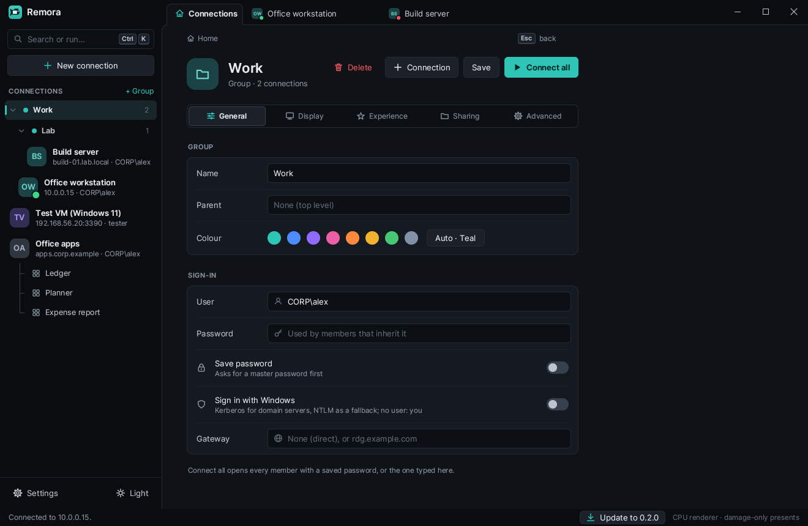

- A group has a **name**, a **parent** and a **colour**. **Auto** picks a
  colour from the name, or takes the parent's.
- A group can hold a sign-in (user, password, Windows sign-in, gateway),
  display settings and sharing, on the same pages as a connection.
- In a connection inside a group, the switches **Use the group's sign-in**,
  **Use the group's display settings** and the one on the Sharing page take
  that part from the group instead. A group can in turn take a part from its
  parent. The Summary column shows which group each part comes from.
- **Connect all** opens every connection in the group, and in the groups
  inside it, that has a saved password or uses the password typed into the
  group.
- **+ Connection** on a group page adds a new connection to it.

## Sessions

Each session runs in its own tab.

**The toolbar** floats at the top of the picture. It hides while you work in
the session; move the pointer to the top edge, tap the small handle it leaves,
or hold **Alt** to bring it back. Its buttons, from the left:

- the session's name and status (and **REC** while recording);
- **Panel**: the side panel (below);
- **Full screen**;
- **Record**;
- **Ctrl+Alt+Del**;
- **Disconnect**;
- **Command palette**;
- **More**: **Keep toolbar shown**, **Reconnect** and **Close tab**.

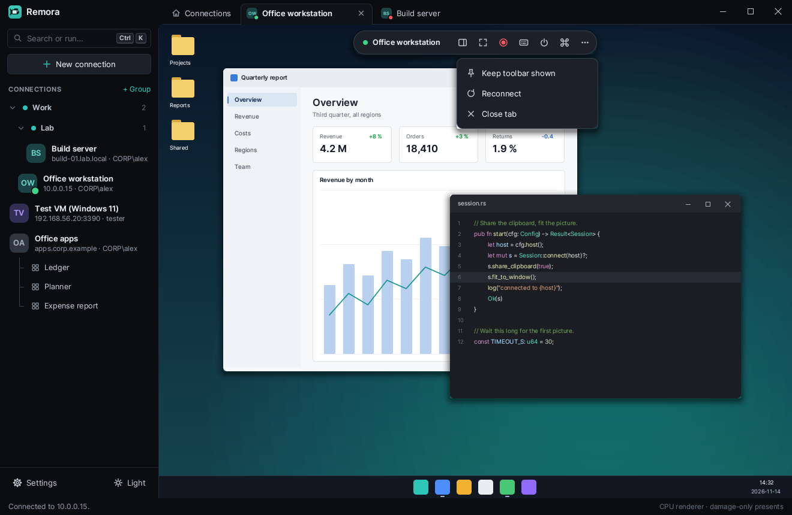

**The side panel** has four pages:

- **Sharing**: switch clipboard, sound, microphone, printers and smart cards,
  and share folders, live.
- **Display**: full screen, **Fit to window** and the scale, which apply
  live.

  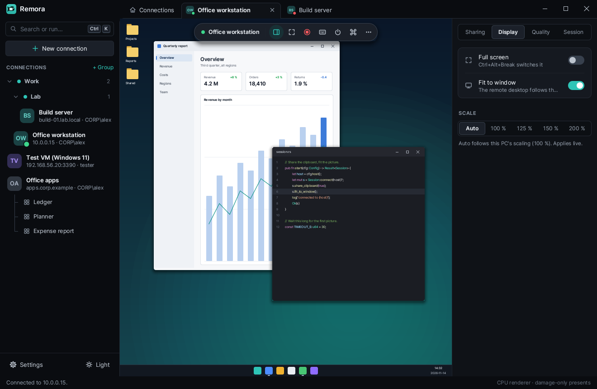

- **Quality**: connection speed, colours and what to show. These apply at
  logon, so the page offers **Reconnect now**.

  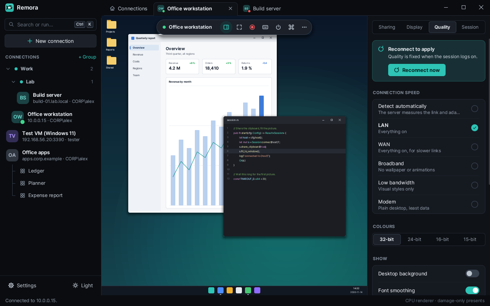

- **Session**: the host (and where a broker moved the session), the status,
  desktop size, colours, speed, keyboard layout and the measured network
  round trip and bandwidth; the Windows keys and keyboard settings; and
  **Send Ctrl+Alt+Del**, **Reconnect** and **Disconnect**.

  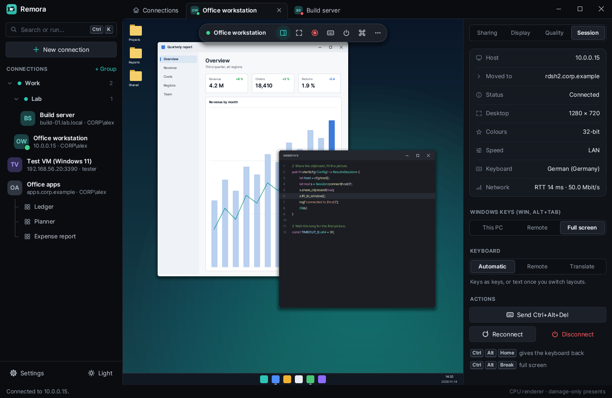

**Floating or pinned.** By default the side panel folds to a slim strip at
the picture's right edge with an icon per page (point at one for its name).
Click an icon, the toolbar's **Panel** button, or press **Ctrl+Alt+P** (also
while the session has the keyboard) and the panel opens on that page,
floating over the right part of the picture. The remote desktop keeps its
size, so nothing is resized. While it is open the session gets no mouse
input: click anywhere on the picture, click the open page's icon again, use
the panel's **×** or press **Esc** to close it. That click and that Esc are
not sent to the session, and Esc gives the keyboard back to the session if
Ctrl+Alt+P took it from there.

The pin in the panel's header docks it beside the picture instead: the
picture gets narrower (a desktop set to **Fit window** is resized to the new
area) and the panel stays open; the toolbar's **Panel** button hides it, and
a page icon in the strip docks it again. The lit pin of the docked panel
floats it again. Remora remembers the choice; the command palette has
**Pin session panel** / **Unpin session panel** and **Show session panel**
too. In full screen there is no strip: the toolbar's **Panel** button opens
the floating panel, with the page switcher at its top.

Drag the side panel's left edge to make it wider or narrower (280 to 560 px);
a double-click on the edge puts the default width back, and Remora remembers
the width. A desktop set to **Fit window** follows the docked panel: it is
resized to the new picture area once you let go of the edge.

When the network drops, Remora reconnects on its own, up to five times. When a
session fails or ends, the tab says why; see
[Troubleshooting](TROUBLESHOOTING.md). Quitting Remora with sessions open
asks first.

## Sharing

Every kind of sharing is off until you switch it on. Set it per connection
(the editor's Sharing page), for a group, or live in a running session (the
side panel's Sharing page, or the command palette). Live switches do not
need a reconnect.

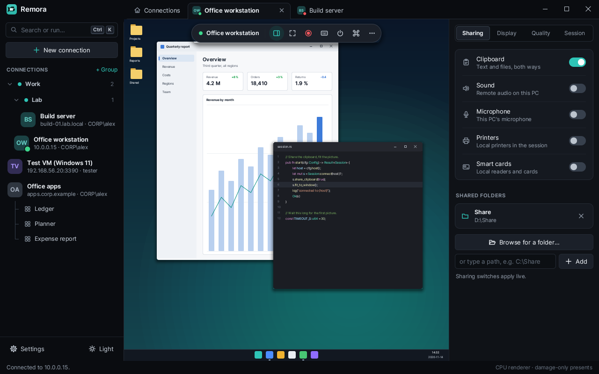

- **Clipboard**: copy and paste text and files, both ways.
- **Sound**: the session's sound plays on this PC, on the output you choose
  under **Play sound on**.
- **Microphone**: this PC's microphone in the session, from the device you
  choose under **Record from**.
- **Printers**: this PC's printers in the session, through Easy Print, so the
  server needs no printer drivers.
- **Smart cards**: this PC's card readers and cards, for example to sign in
  inside the session.
- **Shared folders**: a folder of this PC appears as a drive in the session's
  Explorer. **Browse for a folder…**, or type a path and click **Add**. The
  server can reach only what is inside that folder.

## Server helper

`remora-agent` is a small, optional helper that runs inside your session on
the server. With it, Remora shows the server's state, opens links you click
there in your own browser, and copies files both ways with resume. Without
it nothing changes: Remora shows nothing about a helper until one connects.
How to install it on the server: `crates/remora-agent/README.md`.

The helper talks to Remora through the RDP connection that is already open
(no extra port, no firewall rule), end-to-end encrypted on top of the
connection's TLS. It can never run anything on this PC.

### Pairing

The first time a helper connects from a server, Remora asks **Pair the
server helper?** over the session and shows a six-digit code. The helper
shows the same code on the server; compare them, then **Pair** (Enter) or
**Don't pair** (Esc). While the question is up, the keyboard and mouse do
not reach the session. After pairing, Remora remembers the helper's key for
that server, and later sessions pair silently.

If the key is different from last time, Remora warns: **The server helper's
key changed**. A reinstalled helper does this, but so does an attack; here
Enter and Esc both mean **Don't pair**, and only **Pair anyway** pairs.

To forget a paired helper: **Forget…** on the editor's Sharing page, or
**Forget paired helper** in the command palette. Its next session asks to
pair again.

### What it may do

Set per connection on the editor's Sharing page, under **Server helper**
(inherited with the rest of Sharing). Everything but session info is off
until you switch it on; a change applies from the next connection.

- **Session info** (always): the side panel's Session page shows the helper's
  version, whether the remote screen is locked, idle time, CPU and memory.
- **Open links on this PC**: a card asks **Open**, **Always for this server**
  or **Ignore** for each link, showing where it goes first. Only http and
  https links ever open; the address is checked again before your browser
  gets it. **Open them without asking** (or **Always for this server**)
  skips the question for that connection.
- **Receive files from the server**: a card asks **Save** or **Decline** for
  each file. Files go only into **Save received files in** (default
  `Downloads\Remora`), are never written over (a second copy becomes
  `name (2).ext`), and are marked as downloaded from the Internet, so
  Windows and Office treat them with care.
- **Send files to the server**: drop files onto the session (the drop target
  says where they go, or why it cannot take them), or **Send files to…** on
  the side panel's Sharing page or in the palette.

If the server's policy turns off clipboard or drive redirection, file
transfer is off too, whatever the switches say.

### Transfers

The side panel's Sharing page lists the files on their way, with progress,
speed and time left; **×** cancels one, the folder button shows a received
file in Explorer, **Clear finished** tidies the list. If the connection
drops, transfers pause and continue where they stopped once the session is
back (also after an automatic reconnect). **Show transfers** in the palette
opens the list.

## Monitors and full screen

- **Full screen**: the toolbar button, **Ctrl+Alt+Break**, or the side panel's
  Display page. In full screen the toolbar hides at the top edge.

  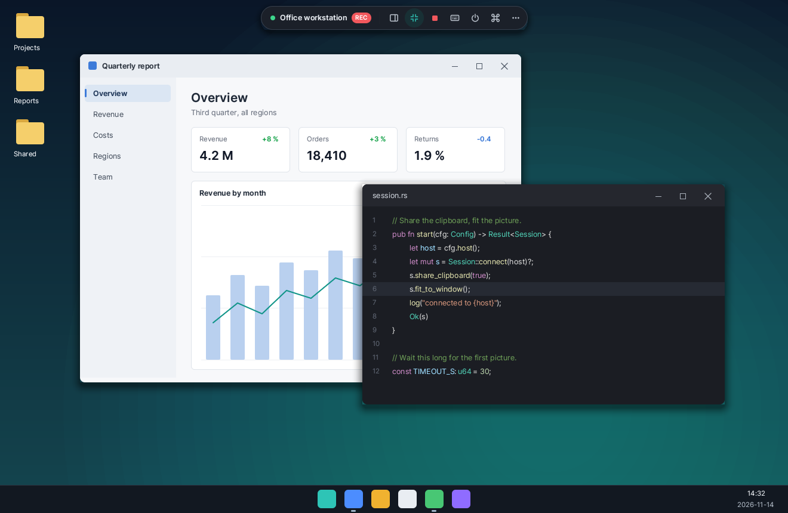

- **Several monitors**: on the editor's Display page, click the monitors you
  want on the map. All of them or only some work. The session then opens
  full screen with one window on each chosen monitor, and the remote desktop
  spans them. The tab says where the session is.

  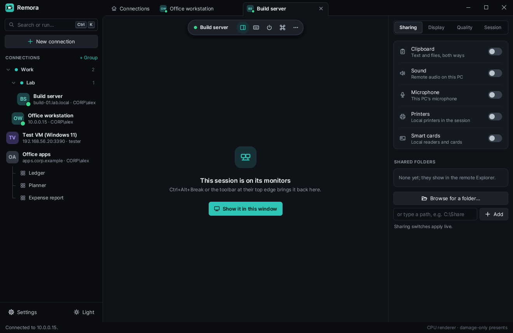

- **Ctrl+Alt+Break**, the **Show in this window** command, or the toolbar on
  the monitors bring the session back into its tab.

## RemoteApp

Any connection can start single programs instead of the whole desktop. Each
program window appears on your own desktop and taskbar, as if it ran on this
PC. A connection's programs are always listed under it, whether it opens the
desktop or apps: **Opens** decides only what **Connect** does.

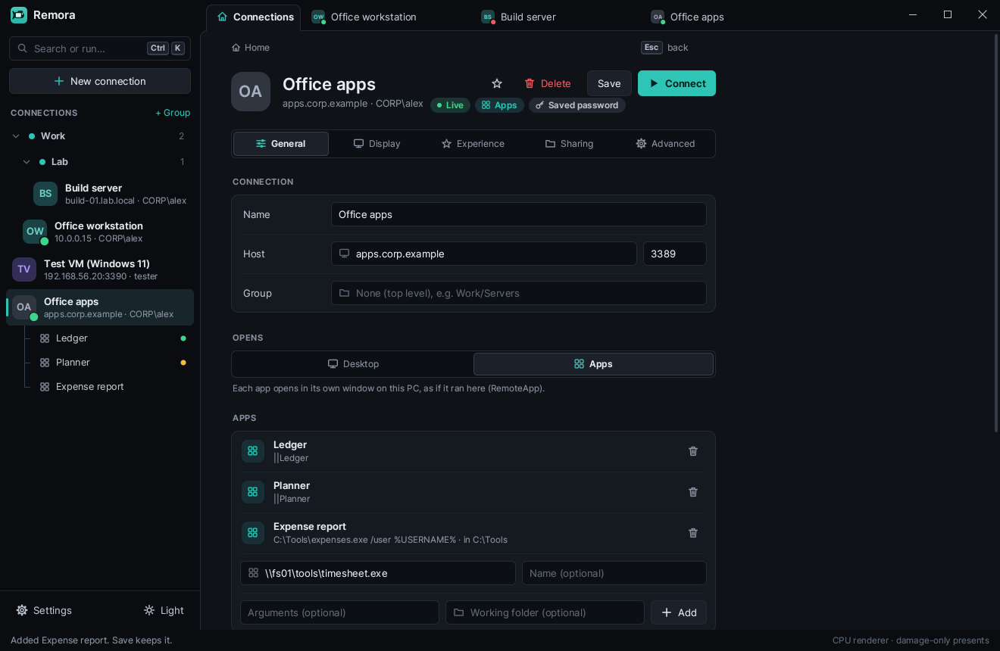

- Add programs on the General page: a published name such as `||Ledger`, or
  a path on the server such as `C:\Tools\app.exe`, with optional arguments,
  working folder and display name. Then click **Add** and **Save**.
- The programs appear under the connection in the sidebar and in the command
  palette. Click one to start it. **Connect** opens the desktop, or starts the
  first program when **Opens** is **Apps**. The first program start signs in;
  later ones use the running RemoteApp session.
- The session's tab lists the open windows (**Focus**, **Close**) and the
  programs (**Start**, **Start another**), with a dot for running and
  starting.

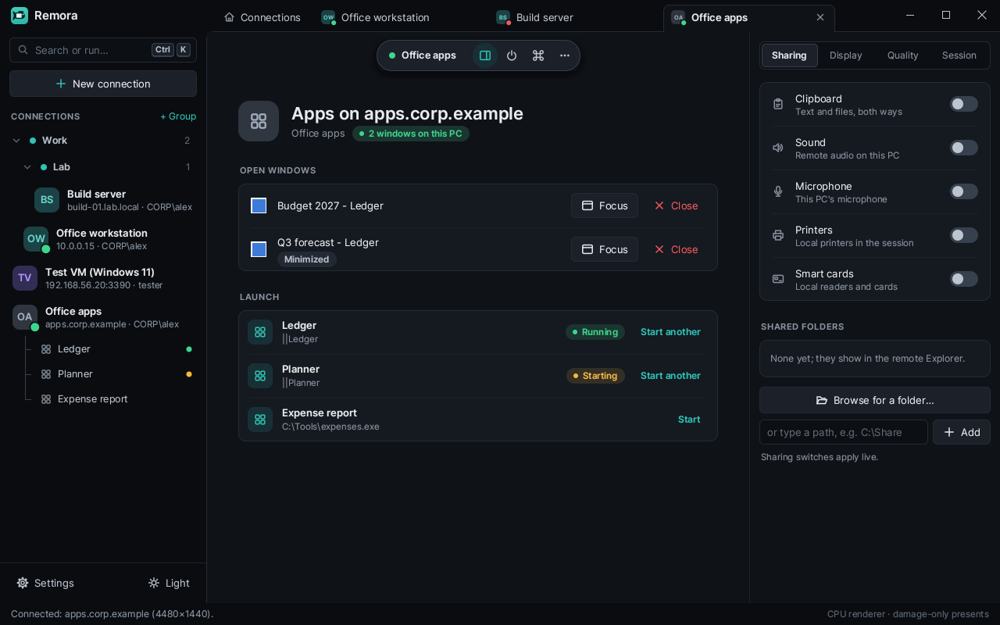

The server must publish the programs (or allow unlisted ones) for RemoteApp.

## Recording

**Record** on the toolbar (or **Record session** in the command palette)
records the session's picture to an MP4 video. **REC** shows on the toolbar
while it runs; press the button again to stop and save. Videos go to
`Videos\Remora`, named after the connection with the date and time. Sound is
not recorded.

## Keyboard

Click into the remote picture to send your keyboard to the session;
**Ctrl+Alt+Home** gives it back. [SHORTCUTS.md](SHORTCUTS.md) lists every key.

Every session starts with this PC's keyboard layout. The **Keyboard** setting
(on the editor's Experience page, and live on the side panel's Session page)
decides what happens when the layouts differ:

- **Automatic** (the default): keys go as keys while the layouts match. When
  you switch this PC to another layout, what you type is sent as text, so the
  characters stay right.
- **Remote**: always keys; the session's layout decides the characters.
- **Translate**: text always as typed here; shortcuts and special keys stay
  keys.

The touch keyboard and the emoji panel work too: their characters are sent as
text.

**Windows keys** such as Win, Alt+Tab and Alt+Esc go to this PC, to the
session, or to the session only in full screen (the default); see the
Advanced page.

**Ctrl+Alt+Del**: the toolbar's keyboard button, the side panel, or the
palette.

## The command palette

**Ctrl+K** (or a click into the empty search field in the sidebar) opens the
command palette. Type to search everything Remora can do right now: sessions,
saved connections, RemoteApp programs, groups, actions such as **New
connection** or **Check for updates**, and settings such as the theme.
**Enter** runs the highlighted result; **Esc** closes it.

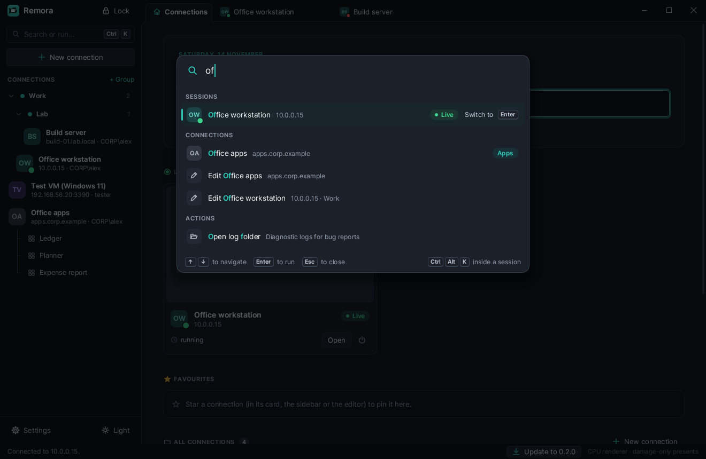

Inside a session, **Ctrl+Alt+K** opens it over the remote desktop with that
session's own commands first: disconnect, reconnect, full screen, each
sharing switch with its current state, shared folders, keyboard mode, fit to
window, recording and the panel.

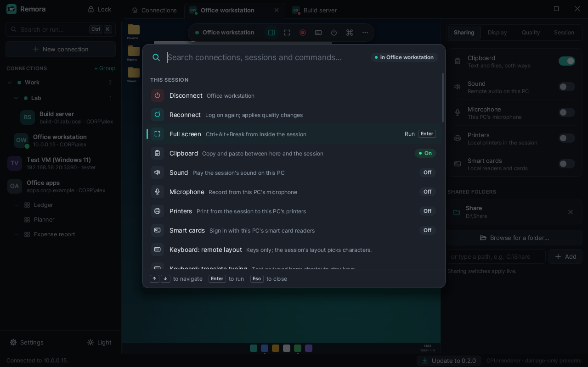

## Themes

**Dark** is the default. **Light** has the same layout. **System** follows the
Windows app theme and switches with it. Choose in **Settings**, under
**Appearance**, with the switch at the bottom of the sidebar, or in the
command palette.

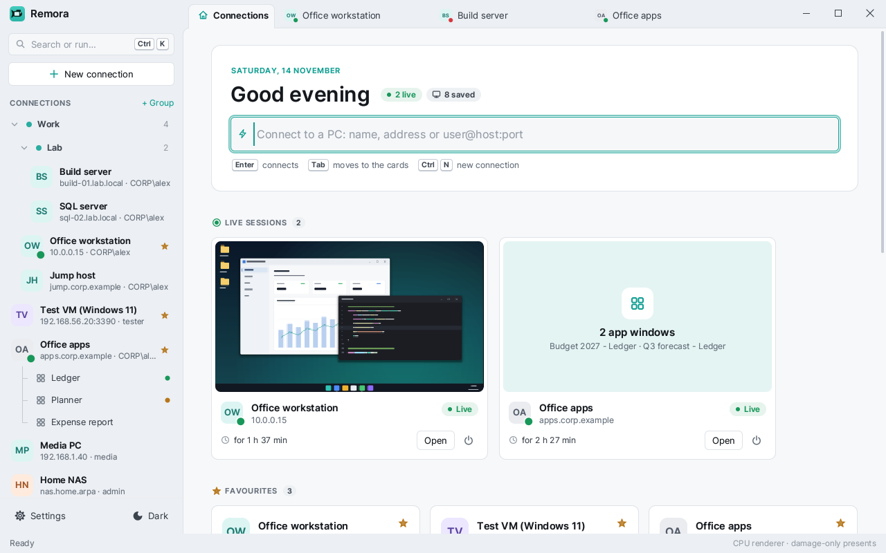

## The vault

Remora saves passwords only in an encrypted vault, protected by a master
password of at least 8 characters. Set it up in **Settings** under
**Security**, or switch on **Save password** in a connection.

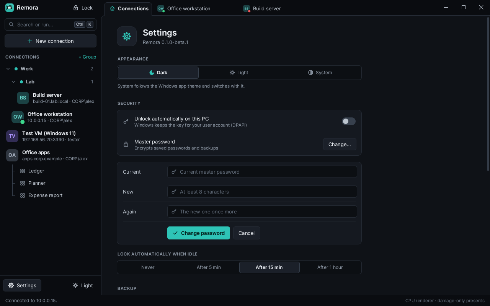

- **Lock automatically when idle**: never, after 5 minutes, 15 minutes (the
  default) or 1 hour.
- **Lock** at the top of the sidebar locks it at once. A locked Remora asks
  for the master password before it shows your connections.
- **Unlock automatically on this PC** lets Windows keep the key for your user
  account, so you are not asked.
- **Change…** sets a new master password.

How the vault is encrypted, and what is stored where, is in
[SECURITY.md](SECURITY.md).

## Backup and import

**Settings** has a **Backup** section.

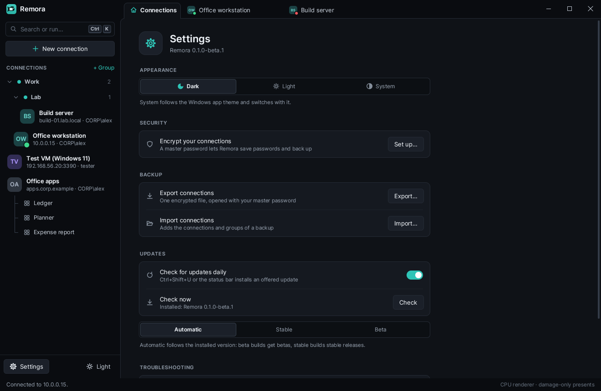

- **Export…** writes all connections and groups, with their saved passwords,
  to one `.rdpbackup` file encrypted with your master password. It needs a
  master password; set one up first under **Security**.
- **Import…** reads such a file. Type the master password it was made with;
  its connections and groups are added to yours. Connections you already
  have (same name, host and group) are skipped.

The first start also offers **Import connections**.

## Updates

In **Settings**, under **Updates**:

- **Check for updates daily** (on by default) lets an installed copy ask
  GitHub once a day for a new release. **Check now** asks at once.
- Below it, choose the channel: **Automatic** follows the installed version
  (beta builds get betas, stable builds stable releases), or **Stable** or
  **Beta**.

When an update is ready, the status bar shows **Update to …**. Click it, or
press **Ctrl+Shift+U**, and Remora downloads the setup, checks it against the
release's `SHA256SUMS.txt`, closes, installs and starts again.

Portable copies do not check for updates; new versions are on the
[releases page](https://github.com/rennerdo30/rdp-rs/releases).

## The command line

`remora.exe` also connects from the command line, takes headless screenshots
and recordings, and prints a protocol trace. See the
[README](../README.md#build-and-run).
