# Remora user guide

Every screen and setting of Remora, the Remote Desktop client. New to it?
Start with [Getting started](GETTING-STARTED.md).

- [The window](#the-window)
- [Home](#home)
- [Connections and the editor](#connections-and-the-editor)
- [Groups](#groups)
- [Sessions](#sessions)
- [Sharing](#sharing)
- [Server helper](#server-helper)
- [Monitors and full screen](#monitors-and-full-screen)
- [RemoteApp](#remoteapp)
- [Recording](#recording)
- [SSH](#ssh)
- [Keyboard](#keyboard)
- [The command palette](#the-command-palette)
- [Themes](#themes)
- [The vault](#the-vault)
- [Backup and import](#backup-and-import)
- [Updates](#updates)
- [The command line](#the-command-line)

## The window

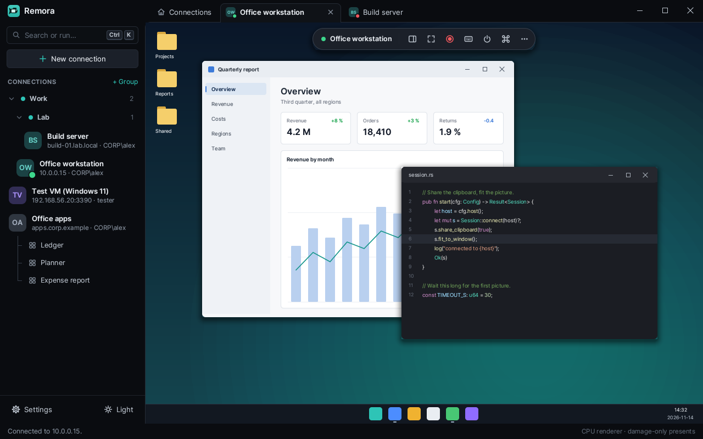

- **The sidebar** on the left lists your connections in their groups, with a
  dot for each running session. At its top are the search field (click it,
  or press **Ctrl+K**, for the command palette; **Ctrl+F** filters the list)
  and **New connection**. At the bottom are **Settings** and a switch between
  the dark and light theme.
  - **Fold it to a rail**: the menu button (three bars) at its top left, or
    **Ctrl+B**, or **Collapse sidebar** in the command palette. The rail keeps
    Home, search, **New connection**, Settings and the theme as icons, and
    shows each connection as its initials with its live dot; point at one for
    its name, address and apps, click it to open it. Connections that do not
    fit become a **+N** button that unfolds the sidebar. The same button or
    **Ctrl+B** unfolds it; **Ctrl+F** unfolds it to filter.
  - **Resize it**: drag its right edge (the pointer turns into a resize
    arrow), from 200 to 480 px wide. Dragging it narrower than that folds it
    to the rail; dragging the rail's edge out unfolds it. A double-click on
    the edge puts the default width back. Remora remembers the width and
    whether the sidebar is folded.
- **The tabs** at the top: **Connections** (Home, the editor and Settings),
  then one tab per session. **Ctrl+Tab** and **Ctrl+Shift+Tab** switch
  between them.
- **The status bar** at the bottom says what just happened, and shows an
  **Update** button when a new version is ready.

## Home

Home is the first page of the Connections tab.

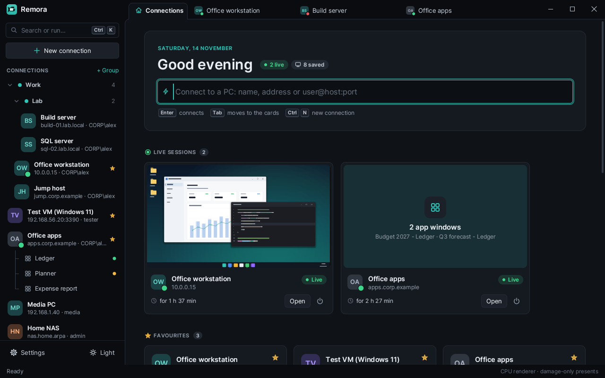

- **Quick connect** at the top takes a saved connection's name (a few letters
  are enough), a computer name or address, or `user@host:port`. **Up** and
  **Down** pick a match; **Enter** connects. If a session of that connection
  already runs, Remora shows it instead of opening a second one. A new
  address opens the editor to ask for the sign-in.
- **Live sessions** show a thumbnail of each running desktop, updated while
  Home is open, and how long the session has run. **Open** shows it; the
  power button disconnects it. A session you started without saving its
  connection has a **Save** button here.
- **Favourites** are the connections you pinned with the star in the editor.
  **Recent** lists the ones you used last, newest first.

**Tab** walks from the field through the cards; **Enter** opens the one
in focus.

## Connections and the editor

Click a connection in the sidebar to open it in the editor, or press
**Ctrl+N** for a new one. **Save** (**Ctrl+S**) keeps your changes;
**Connect** (**Enter**) starts a session with what the form shows, saved or
not. **Esc** goes back to Home. The star pins the connection to Favourites;
**Delete** removes it.

On a wide window, a **Summary** column next to the form says in plain words
what Connect will do, and which group each inherited part comes from.

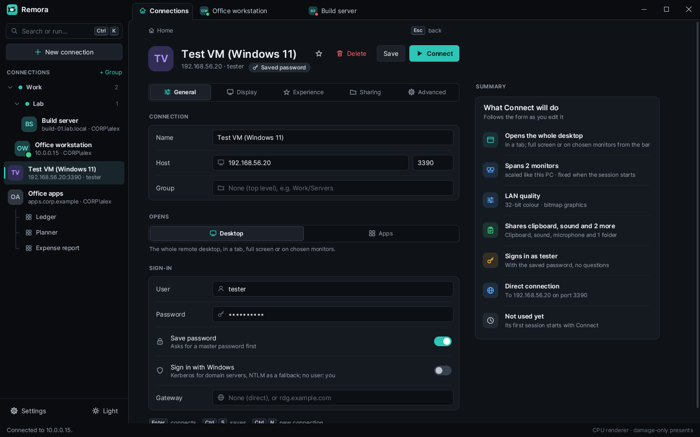

The editor has five pages.

### General

- **Type**: **Remote Desktop**, or **SSH** for a host that opens in a
  terminal (see [SSH](#ssh)). An SSH connection has only this page.
- **Name**, **Host** and port (3389 unless the server uses another), and
  **Group** (for example `Work/Servers`; empty for the top level).
- **Opens**: what **Connect** (and **Enter**) starts: **Desktop** (the
  default) for the whole remote desktop, or **Apps** for the first of the
  connection's programs in its own window (see [RemoteApp](#remoteapp)).
- **Apps**: the connection's RemoteApp programs. They are listed under the
  connection in the sidebar whatever it opens, and each one starts on its
  own.
- **Sign-in**: **User** (`name`, `DOMAIN\name` or `name@domain`) and
  **Password**.
  - **Save password** keeps the password in the encrypted vault. It asks you
    to set a master password first.
  - **Sign in with Windows** uses Windows' own sign-in: Kerberos for domain
    servers, NTLM as a fallback. With no user name, it signs in as you.
  - **Gateway**: an RD Gateway as `host` or `host:port`, or empty for a
    direct connection. The gateway gets the same user name and password.
    Remora uses the gateway's HTTP transport, and RPC over HTTP when the
    gateway does not offer HTTP (older gateways, or HTTP turned off).
  - **Gateway over RPC** (shown once a gateway is entered) skips the HTTP
    attempt and uses RPC over HTTP only. On the command line:
    `--gateway-rpc`.
  - **Jump host**: an SSH server the connection goes through, as
    `user@host` or `user@host:port`, or empty for none (see
    [SSH](#ssh)). A connection has a gateway or a jump host, not both.
  - **Key file** (shown once a jump host is entered): the private key for
    the jump host; empty uses the keys of the OpenSSH agent.

### Display

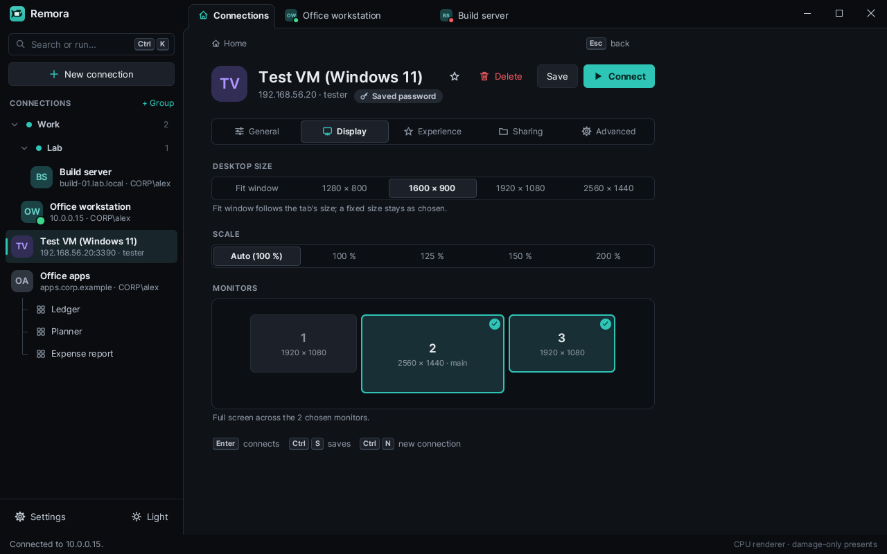

- **Desktop size**: **Fit window** (the remote desktop follows the tab's
  size) or a fixed 1280 × 800, 1600 × 900, 1920 × 1080 or 2560 × 1440.
- **Scale**: **Auto** follows this PC's Windows scaling; or 100, 125, 150 or
  200 %.
- **Monitors**: click monitors on the map to use them; see
  [Monitors and full screen](#monitors-and-full-screen).

### Experience

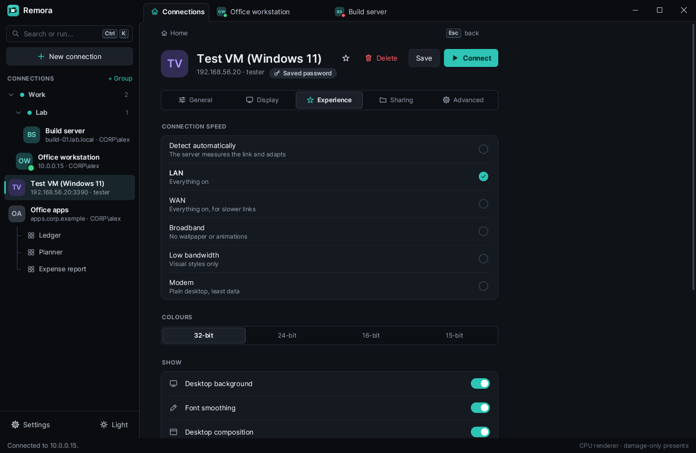

- **Connection speed**: **Detect automatically** (the server measures the
  link and adapts), or a preset from **LAN** to **Modem**. Each preset sets
  the switches below the way Windows' own client does.
- **Colours**: 32, 24, 16 or 15-bit.
- **Show**: desktop background, font smoothing, desktop composition, window
  contents while dragging, menu and window animations, visual styles.
- **Input**: **Touch and pen** sends touch and pen (with pressure and tilt)
  to the session when the server supports it; off, they act as the mouse.
- **Keyboard**: see [Keyboard](#keyboard).

### Sharing

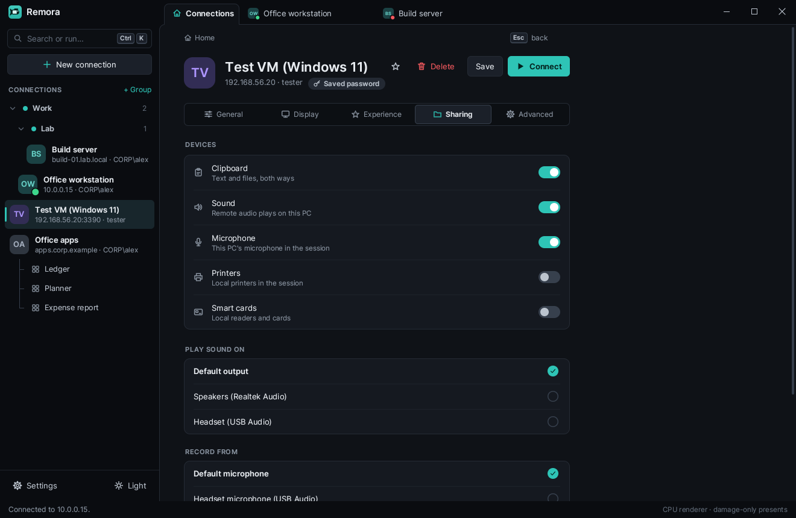

What the session may use from this PC, from the moment it starts. See
[Sharing](#sharing). The **Server helper** switches at the bottom are
explained in [Server helper](#server-helper).

### Advanced

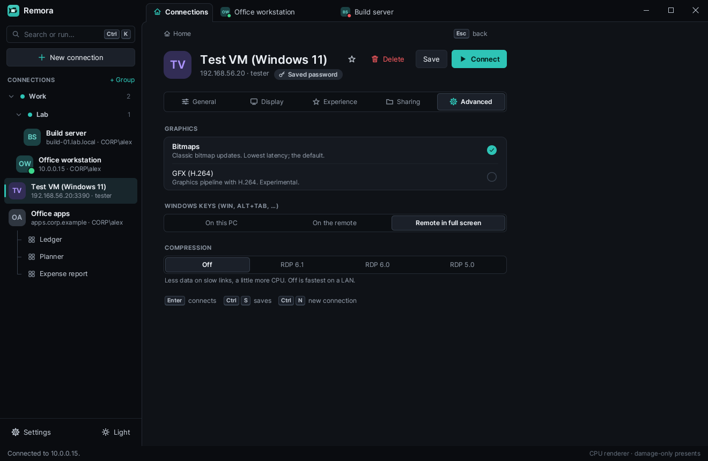

- **Graphics**: **GFX (H.264)**, the graphics pipeline with H.264 (the
  default: smoother video and less traffic), or **Bitmaps**, classic bitmap
  updates, for a server or setup where GFX misbehaves. When a server's
  graphics fail, Remora reconnects the tab once with bitmaps on its own.
- **Video redirection** (off by default; needs GFX): Remora offers Windows'
  Video Optimized Remoting. When the server decides that part of the screen
  is a playing video, it can send that part as its own H.264 stream instead
  of painting it into the desktop picture; Remora decodes it on this PC and
  shows it in the video's place, clipped where windows cover it and at the
  pace of the video's own timestamps. Nothing changes unless the server
  chooses to redirect a video; which servers and settings do so is still
  being checked, so the switch is off until then. Applies on the next
  connect, like the other quality settings.
- **UDP transport** (off by default): when the server offers it, the
  session's dynamic channels (the GFX picture, sound, touch, display changes)
  travel over UDP next to the TCP connection, as with Windows' own client.
  On a link with loss or a long round trip, UDP keeps the picture moving
  where TCP would stall to resend. Remora uses the reliable UDP mode with TLS
  (the server must show the same certificate as on TCP), only on direct
  connections (not through an RD Gateway). If UDP cannot be set up (a
  firewall blocks UDP 3389, no answer, a TLS error), the session simply
  stays on TCP. If UDP breaks while the session uses it, Remora reconnects
  the tab (resuming the same Windows session) and keeps it on TCP. The statistics box shows which transport is
  in use. Applies on the next connect.
- **Windows keys (Win, Alt+Tab, …)**: **On this PC**, **On the remote** (the
  default), or **Remote in full screen**.
- **Compression**: **Off** is fastest on a LAN; RDP 6.1, 6.0 or 5.0 send less
  data on slow links for a little more CPU.
- **Security: Allow legacy RDP security (weak)**, off by default. Only for
  old servers that have no TLS (Windows' "RDP Security Layer", or servers
  set to it): Remora then connects with Standard RDP Security, RC4
  encryption (Triple DES at the FIPS level) without TLS. It is weak: anyone on the network path can
  intercept the session, and the server's identity rests only on the key it
  showed the first time (Remora asks you to trust it, like a certificate).
  TLS is still used whenever the server offers it; Remora never picks the
  legacy security on its own. The switch belongs to the connection, not to
  its group, and the connection shows a **Legacy security** label. A server
  that offers only legacy security and a connection without the switch end
  with "This server only offers legacy, weak security".

## Groups

Groups keep the sidebar in order and share settings. Click **+ Group** in the
sidebar, or type a group path into a connection's **Group** field: `/` makes
groups inside groups (`Work/Lab`).

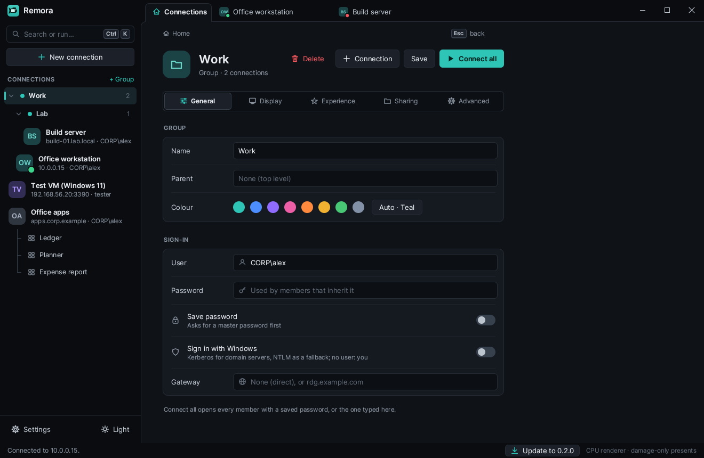

- A group has a **name**, a **parent** and a **colour**. **Auto** picks a
  colour from the name, or takes the parent's.
- A group can hold a sign-in (user, password, Windows sign-in, gateway),
  display settings and sharing, on the same pages as a connection.
- In a connection inside a group, the switches **Use the group's sign-in**,
  **Use the group's display settings** and the one on the Sharing page take
  that part from the group instead. A group can in turn take a part from its
  parent. The Summary column shows which group each part comes from.
- **Connect all** opens every connection in the group, and in the groups
  inside it, that has a saved password or uses the password typed into the
  group.
- **+ Connection** on a group page adds a new connection to it.

## Sessions

Each session runs in its own tab.


**The toolbar** floats at the top of the picture. It hides while you work in
the session; move the pointer to the top edge, tap the small handle it leaves,
or hold **Alt** to bring it back. Its buttons, from the left:

- the session's name and status (and **REC** while recording);
- **Panel**: the side panel (below);
- **Full screen**;
- **Record**;
- **Ctrl+Alt+Del**;
- **Disconnect**;
- **Command palette**;
- **More**: **Keep toolbar shown**, **Reconnect** and **Close tab**.

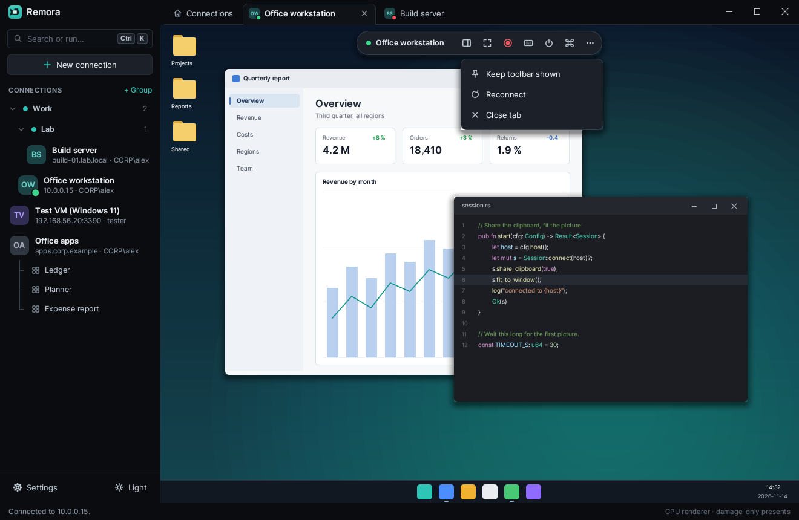

**The side panel** has four pages:

- **Sharing**: switch clipboard, sound, microphone, camera, printers, smart
  cards and ports, and share folders, live.
- **Display**: full screen, **Fit to window** and the scale, which apply
  live.

  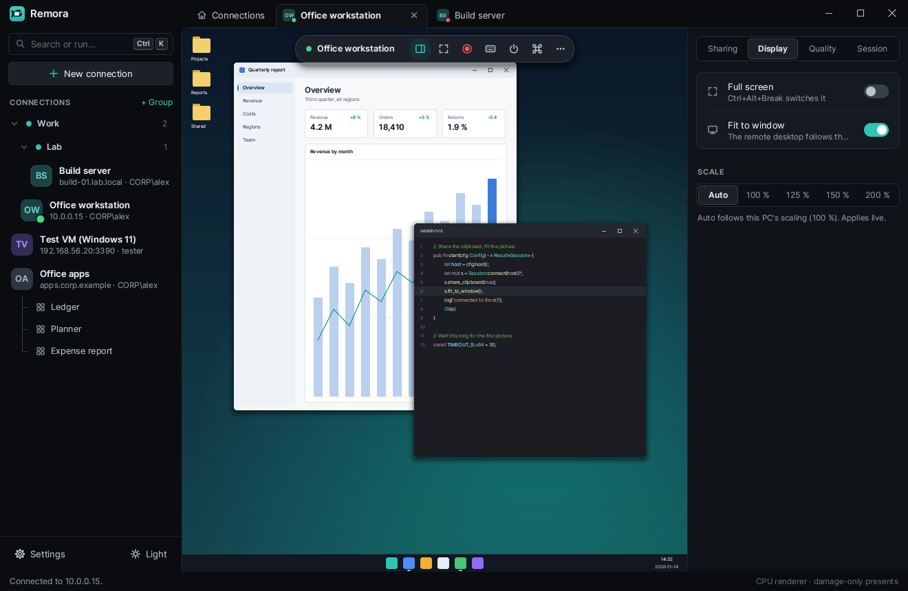

- **Quality**: connection speed, colours, what to show, graphics and video
  redirection. These apply at logon, so the page offers **Reconnect now**.

  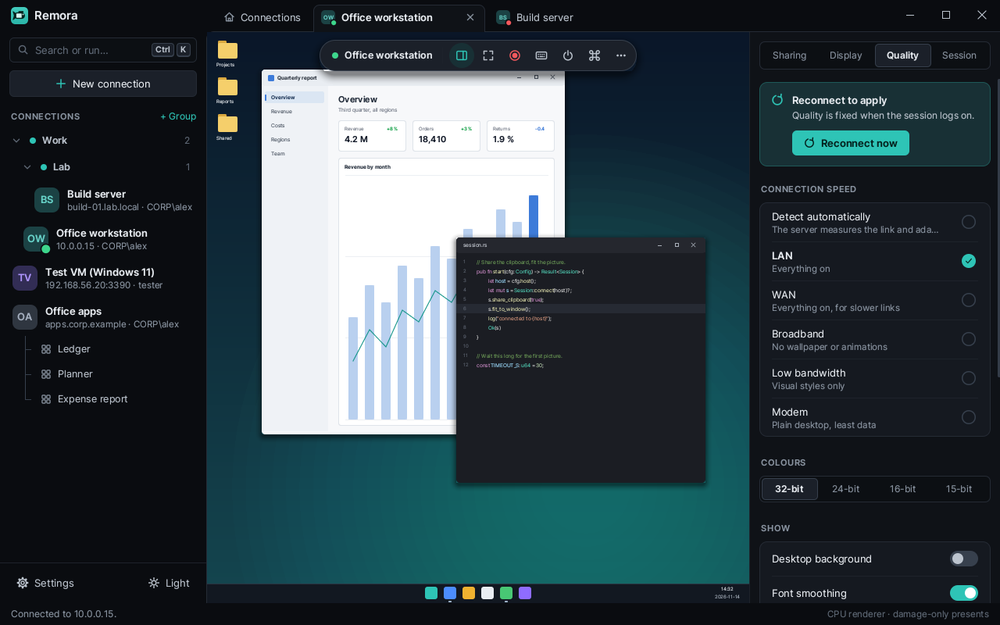

- **Session**: the host (and where a broker moved the session), the status,
  desktop size, colours, speed, keyboard layout and the measured network
  round trip and bandwidth; the Windows keys and keyboard settings; and
  **Send Ctrl+Alt+Del**, **Reconnect** and **Disconnect**.

  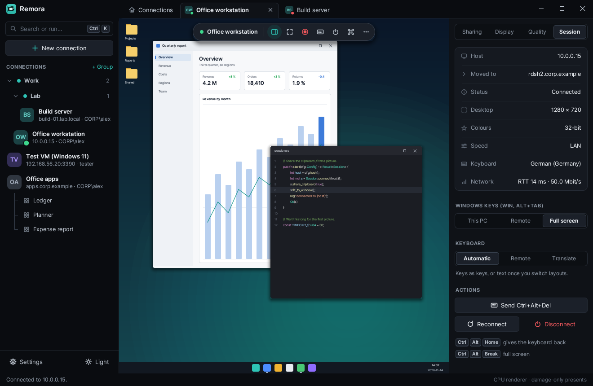

**Floating or pinned.** By default the side panel folds to a slim strip at
the picture's right edge with an icon per page (point at one for its name).
Click an icon, the toolbar's **Panel** button, or press **Ctrl+Alt+P** (also
while the session has the keyboard) and the panel opens on that page,
floating over the right part of the picture. The remote desktop keeps its
size, so nothing is resized. While it is open the session gets no mouse
input: click anywhere on the picture, click the open page's icon again, use
the panel's **×** or press **Esc** to close it. That click and that Esc are
not sent to the session, and Esc gives the keyboard back to the session if
Ctrl+Alt+P took it from there.

The pin in the panel's header docks it beside the picture instead: the
picture gets narrower (a desktop set to **Fit window** is resized to the new
area) and the panel stays open; the toolbar's **Panel** button hides it, and
a page icon in the strip docks it again. The lit pin of the docked panel
floats it again. Remora remembers the choice; the command palette has
**Pin session panel** / **Unpin session panel** and **Show session panel**
too. In full screen there is no strip: the toolbar's **Panel** button opens
the floating panel, with the page switcher at its top.

Drag the side panel's left edge to make it wider or narrower (280 to 560 px);
a double-click on the edge puts the default width back, and Remora remembers
the width. A desktop set to **Fit window** follows the docked panel: it is
resized to the new picture area once you let go of the edge.

**Show statistics** (a switch on the side panel's Session page, also in the
toolbar's **⋯** menu and the command palette) shows a small statistics box
at the picture's top left, updated once a second; Remora remembers whether it
is on. It shows:

- **Round trip:** a ping to the server, once a second. A server that does not
  answer pings shows Windows' TCP estimate instead, marked "no ping reply":
  it includes the server's delayed acknowledgements, so it reads well above
  the network's real round trip. A session through an RD Gateway has none.
- **Transport:** **TCP**, or **UDP** with the number of channels on it and
  its own round trip once the UDP transport is up. With UDP switched on, it
  also says when UDP is still connecting, was offered but not used, or
  failed (the session then runs on TCP).
- **Server measured:** what the server's network detection found, when it
  sends one (connection type Automatic).
- **Input → picture:** from a key or mouse button press to the next change of
  the picture, as an average and the worst of the last 20 presses. This is the
  delay you feel: the round trip, the server's reaction and encoding, and
  Remora's decoding. Presses that change nothing on screen are not counted.
- **Graphics:** GFX with its codec and frames per second, and the decoding
  time per frame; or Bitmap.
- **Update → screen:** from a decoded update to the window showing it:
  Remora's own share of the delay, next to the decoding time.
- **Updates and repaints:** picture updates per second and how often the
  window was repainted.
- **Received and sent:** the connection's traffic.

When the network drops, Remora reconnects on its own, up to five times. When a
session fails or ends, the tab says why; see
[Troubleshooting](TROUBLESHOOTING.md). Quitting Remora with sessions open
asks first.

## Sharing

Every kind of sharing is off until you switch it on. Set it per connection
(the editor's Sharing page), for a group, or live in a running session (the
side panel's Sharing page, or the command palette). Live switches do not
need a reconnect.

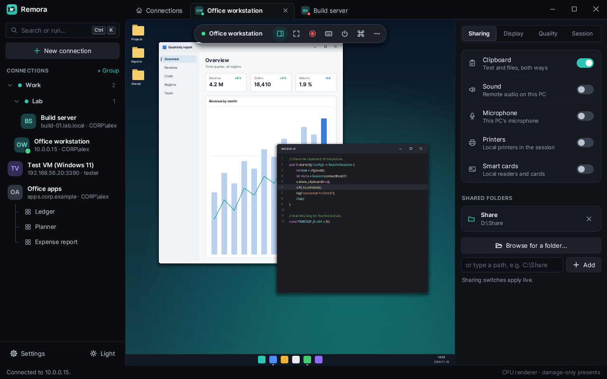

- **Clipboard**: copy and paste text, images and files, both ways. Files
  and folders copied on the server can be pasted on this PC at once: Explorer
  copies them straight from the server with its own progress window, with
  no size limit, and nothing is downloaded until you paste.
- **Sound**: the session's sound plays on this PC, on the output you choose
  under **Play sound on**.
- **Microphone**: this PC's microphone in the session, from the device you
  choose under **Record from**.
- **Camera**: this PC's cameras in the session, for video calls and other
  camera apps there. Choose **All cameras** or one camera under **Share
  camera**. A shared camera appears in the session's apps under its own
  name; it turns on only while an app in the session uses it, and it turns
  off at once when the app stops, when you switch **Camera** off, or when
  the session ends. The session gets the picture in a format the camera
  makes itself (MJPG, YUY2, NV12 and the like, or H.264 where the camera
  offers it). It needs a server running Windows 10 version 1803, Windows
  Server 2019 or later, with video capture redirection allowed. Cameras
  plugged in during a session appear after a reconnect.
- **Printers**: this PC's printers in the session, through Easy Print, so the
  server needs no printer drivers.
- **Smart cards**: this PC's card readers and cards, for example to sign in
  inside the session.
- **Ports**: this PC's serial (COM) and parallel (LPT) ports, one switch
  each, for devices such as barcode scanners, scales, modems or label
  printers. A shared port appears in the session under the same name
  (COM3 stays COM3), and programs there open it as if it were plugged into
  the server. The card shows only when this PC has ports; a port the
  connection names but this PC lacks now (an unplugged USB adapter) shows as
  **Not on this PC now** and is skipped. While the session uses a port,
  programs on this PC cannot open it, and the other way round. Ports
  plugged in later appear the next time you connect or switch a port.
- **Shared folders**: a folder of this PC appears as a drive in the session's
  Explorer. **Browse for a folder…**, or type a path and click **Add**. The
  server can reach only what is inside that folder.

## Server helper

`remora-agent` is a small, optional helper that runs inside your session on
the server. With it, Remora shows the server's state, opens links you click
there in your own browser, and copies files both ways with resume. Without
it nothing changes: Remora shows nothing about a helper until one connects.
How to install it on the server: `crates/remora-agent/README.md`.

The helper talks to Remora through the RDP connection that is already open
(no extra port, no firewall rule), end-to-end encrypted on top of the
connection's TLS. It can never run anything on this PC.

### Pairing

The first time a helper connects from a server, Remora asks **Pair the
server helper?** over the session and shows a six-digit code. The helper
shows the same code on the server; compare them, then **Pair** (Enter) or
**Don't pair** (Esc). While the question is up, the keyboard and mouse do
not reach the session. After pairing, Remora remembers the helper's key for
that server, and later sessions pair silently.

If the key is different from last time, Remora warns: **The server helper's
key changed**. A reinstalled helper does this, but so does an attack; here
Enter and Esc both mean **Don't pair**, and only **Pair anyway** pairs.

The helper remembers this PC too. A helper that does not know this PC yet
(another PC of yours, a reinstalled Remora) shows its code on the server
again, and Remora shows its code even for a helper it knows; until you
confirm on the server, the helper sends no files or links here and takes
none of yours (the card says **Paired here, now confirm the code on the
server**).

The code on the server reaches you inside the remote picture, which a
machine in the middle could redraw (and it could click the server's window
too). Comparing **fingerprints** protects only when both sides are pinned,
so that neither shows a code or a window to fall back on:

- An administrator enters the helper's fingerprint (`remora-agent
  fingerprint` on the server) as the connection's **Fingerprint** under
  **Server helper** on the editor's Sharing page: Remora then accepts only
  that helper and asks no code. Remora also shows the fingerprint under the
  code and on the helper card, but comparing it there by eye does not help
  against a redrawn picture.
- *Settings > Security* shows this PC's fingerprint for `remora-agent
  trust-client` on the server. That also turns on the helper's **pinned
  clients only** mode: a PC it does not know is refused without a window
  (`remora-agent strict on`, or the `PinnedClientsOnly` policy, turn it on
  too).

If pairing attempts keep ending before you answered (twice in one
connection, or three times a day with one server; a pairing that stalls
for 30 seconds, or that is left open when the connection ends or the tab
closes, counts too), someone may be trying codes until one matches: Remora
stops pairing and the helper card says **Pairing blocked**. **Retry
pairing** there (or **Retry helper pairing** in the palette) allows it
again; do that only if you expect the helper.

To forget a paired helper: **Forget…** on the editor's Sharing page, or
**Forget paired helper** in the command palette. Its next session asks to
pair again.

### What it may do

Set per connection on the editor's Sharing page, under **Server helper**
(inherited with the rest of Sharing). Everything but session info is off
until you switch it on; a change applies from the next connection.

- **Session info** (always): the side panel's Session page shows the helper's
  version, whether the remote screen is locked, idle time, CPU and memory.
- **Open links on this PC**: a card asks **Open**, **Always for this server**
  or **Ignore** for each link, showing where it goes first. Only http and
  https links ever open; the address is checked again before your browser
  gets it. **Open them without asking** (or **Always for this server**)
  skips the question for that connection.
- **Receive files from the server**: a card asks **Save** or **Decline** for
  each file. Files go only into **Save received files in** (default
  `Downloads\Remora`), are never written over (a second copy becomes
  `name (2).ext`), and are marked as downloaded from the Internet, so
  Windows and Office treat them with care. That mark needs a folder on an
  NTFS drive: on a FAT or exFAT drive (many USB sticks) files are refused
  with "the download folder's drive can't mark files from the internet",
  and Remora warns when you pick such a folder. Shortcuts and similar files
  Explorer would act on (`.lnk`, `.url`, `.scf`, `.theme`, `desktop.ini`
  ...) are saved with `.download` appended. With this switch off, an
  offered file is refused and Remora says so once.
- **Send files to the server**: drop files or folders onto the session (the
  drop target says where they go, or why it cannot take them), or **Send
  files to…** on the side panel's Sharing page or in the palette. A folder
  goes whole, with its subfolders, and arrives as one folder; on the server,
  **Send To > Send to my PC (Remora)** works on folders too.

If the server's policy turns off clipboard or drive redirection, file
transfer is off too, whatever the switches say.

When the paired helper is older than Remora, a card at the picture's top
right asks whether to update it (**Update**, **Later**, or **Don't ask
again** for that server), and the Session page offers **Update helper to …**. Remora downloads the helper of its own version from
its GitHub release, checks it against the release's checksums and sends it;
the helper replaces itself and reconnects. Helpers older than 0.1.0-beta.9
cannot update this way; replace `remora-agent.exe` by hand once.

On a server without the helper, a small card at the picture's top right
says what it adds, 15 seconds after connecting. **How to install** opens this
section; **Later** hides the card for this connection; **Don't show again**
hides it for that server.

### Server graphics

With a paired helper, the side panel's Session page shows **Server
graphics**: what Windows on the server allows a remote session's picture.

- **Frame rate:** Windows caps remote sessions at 30 fps unless an
  administrator raises it.
- **H.264 (AVC 444):** whether the server prefers H.264 over its other codecs
  (ClearCodec, RemoteFX) for the whole picture.
- **H.264 on the GPU:** whether it may encode on the server's graphics card.

**Improve** asks the helper to set 60 fps and H.264 on the GPU. Windows on
the server shows its administrator prompt in the session; confirm it there,
or decline and nothing changes. Restart the server for the frame rate;
reconnect for H.264. **Restore defaults** removes the three settings again.
Without the GPU, Windows encodes H.264 in software.

**Measure latency** (below the server graphics) times how long a change on
the server takes to reach this window's picture. The helper shows a small
square at the top-left corner of the session and changes its colour 20
times; Remora times each change from asking to the decoded picture. The
result shows the median, the range, and the helper channel's own round trip
for comparison. It takes a few seconds; keep the corner uncovered. Use it to
compare settings, servers or networks: the time includes the server's
encoder, the network and Remora's decoder.

**Use the helper picture** (below the latency meter, experimental) lets
the server helper send the session's picture itself, instead of Windows'
remote desktop picture. Small changes such as typing and menus come
exactly as they are; larger ones are encoded as video on the server's
graphics card when it has one. **Back to the RDP picture** returns to the
normal one, and so does Remora by itself when the stream stops (for example
on the lock screen, or when the session's resolution changes: start it
again then).
Use **Measure latency** with and without it to see which is faster on your
server.

### Transfers

The side panel's Sharing page lists the files on their way, with progress,
speed and time left; **×** cancels one, the folder button shows a received
file in Explorer, **Clear finished** tidies the list. If the connection
drops, transfers pause and continue where they stopped once the session is
back (also after an automatic reconnect). **Show transfers** in the palette
opens the list.

## Monitors and full screen

- **Full screen**: the toolbar button, **Ctrl+Alt+Break**, or the side panel's
  Display page. In full screen the toolbar hides at the top edge.

  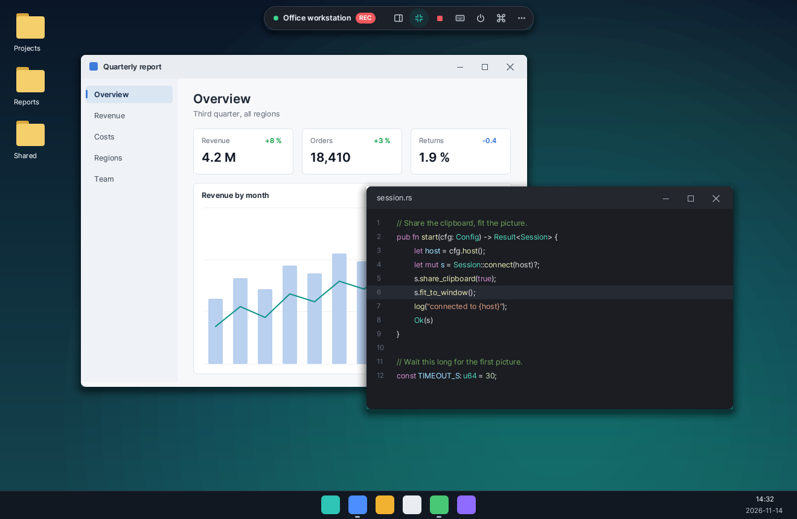

- **Several monitors**: on the editor's Display page, click the monitors you
  want on the map. All of them or only some work. The session then opens
  full screen with one window on each chosen monitor, and the remote desktop
  spans them. The tab says where the session is.

  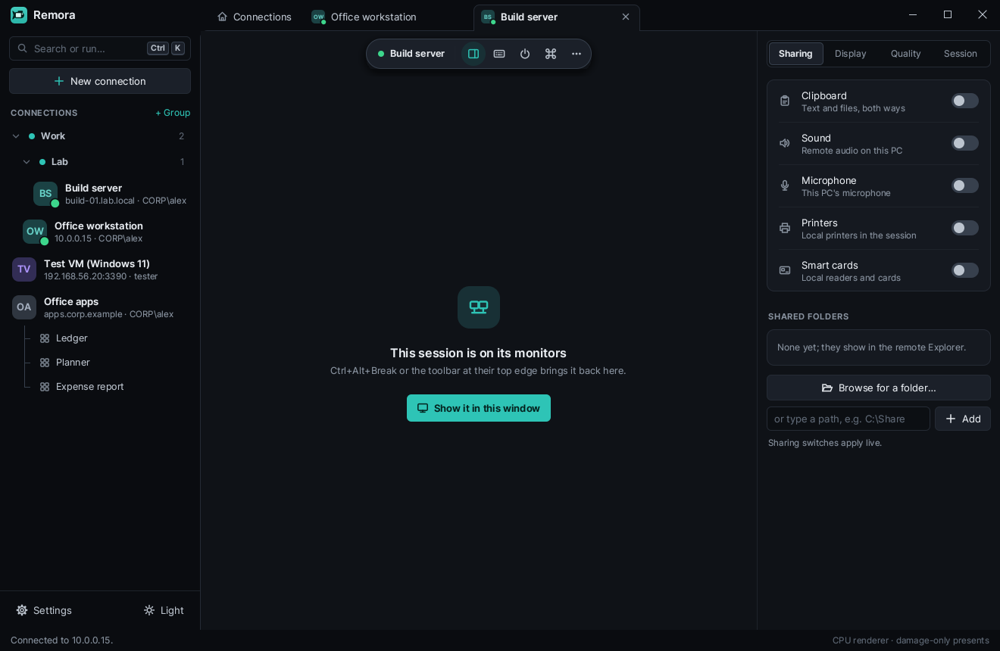

- **Ctrl+Alt+Break**, the **Show in this window** command, or the toolbar on
  the monitors bring the session back into its tab.

## RemoteApp

Any connection can start single programs instead of the whole desktop. Each
program window appears on your own desktop and taskbar, as if it ran on this
PC. A connection's programs are always listed under it, whether it opens the
desktop or apps: **Opens** decides only what **Connect** does.

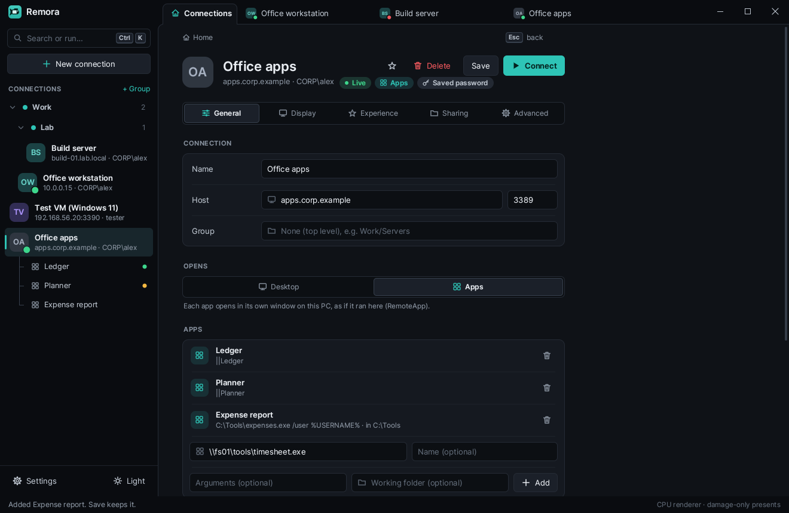

- Add programs on the General page: a published name such as `||Ledger`, or
  a path on the server such as `C:\Tools\app.exe`, with optional arguments,
  working folder and display name. Then click **Add** and **Save**.
- The programs appear under the connection in the sidebar and in the command
  palette. Click one to start it. **Connect** opens the desktop, or starts the
  first program when **Opens** is **Apps**. The first program start signs in;
  later ones use the running RemoteApp session.
- The session's tab lists the open windows (**Focus**, **Close**) and the
  programs (**Start**, **Start another**), with a dot for running and
  starting.

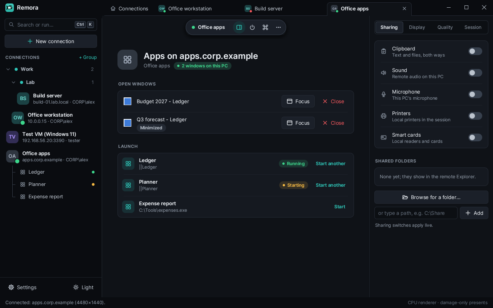

The server must publish the programs (or allow unlisted ones) for RemoteApp.

## Recording

**Record** on the toolbar (or **Record session** in the command palette)
records the session's picture to an MP4 video. **REC** shows on the toolbar
while it runs; press the button again to stop and save. Videos go to
`Videos\Remora`, named after the connection with the date and time. Sound is
not recorded.

## SSH

### SSH connections

Choose **SSH** under **Type** in the editor for a Linux server, a router or
anything else you reach with SSH. It has a host, a port (22), a user and an
optional **Key file**; it sits in the sidebar, Home and the command palette
with an **SSH** tag, and groups and **Connect all** include it.

- **Connect** opens Windows' own OpenSSH client (`ssh.exe`) in a terminal: a
  new Windows Terminal tab when Windows Terminal is installed, else a
  console window. The terminal is yours: closing Remora leaves it open.
- No password is saved for SSH: ssh asks in the terminal, or signs in with
  the key file or a key in the OpenSSH agent (`ssh-add`). Without a user,
  ssh uses your Windows user name.
- ssh checks the server's key itself, in `%USERPROFILE%\.ssh\known_hosts`.
- Without `ssh.exe`, Remora says how to add it: Settings → System →
  Optional features → **OpenSSH Client**.

### Through an SSH jump host

An RDP connection can reach its PC through an SSH server (a bastion or
jump host), like `ssh -J`: set **Jump host** on its General page.

- Remora signs in to the jump host itself and asks it to open the PC's
  RDP port. The Remote Desktop connection runs inside that tunnel unchanged:
  the PC's certificate and your Windows sign-in are checked end to end, and
  the jump host never sees your password.
- Sign-in to the jump host: the **Key file** (a key without a passphrase),
  then the keys of the OpenSSH agent and of Pageant. A key with a
  passphrase belongs in the agent (`ssh-add`). Passwords are not used.
- The jump host's key is trusted like a server certificate: the first
  connection shows its SHA-256 fingerprint and asks; a key already in
  `%USERPROFILE%\.ssh\known_hosts` connects without asking; a changed key
  stops with a warning. Nothing is sent to the jump host before you trust
  its key.
- The steps show **Jump host** first; if it fails, the error screen says
  whether the jump host could not be reached, its key was not trusted, it
  refused the keys, or it could not open the PC.
- No UDP transport is offered through a jump host.

## Shadowing and shared desktops

Remora can watch or control another user's session on a Windows server, as
`mstsc /shadow` does. It can also join a Windows Desktop Sharing invitation.

In the app, open the connection to the server, go to **Advanced** and click
**Sessions…** under **Other sessions** (or run **Sessions on …** from the
command palette). The dialog lists the server's signed-in sessions with
their user and state. **Watch** shows a session; **Control** asks to
control it too. **Ask the user first** is on by default; turned off, the
server's policy must allow shadowing without permission. Closing the dialog
while it waits for the user's answer gives up the request. To join an
invitation file, run **Join a shared desktop** from the command palette.

The same from the command line:

```text
remora server01 --list-sessions
remora server01 --shadow 3                      watch session 3
remora server01 --shadow 3 --control            ask to control it
remora server01 --shadow 3 --no-consent-prompt  without asking its user
remora --invitation invite.xml                  join a Desktop Sharing invitation
```

- `--list-sessions` prints the server's sessions: the ID to shadow, the
  session name, its state and the signed-in user (the dialog lists only
  sessions with a user).
- `--shadow` asks the server for a shadow invitation, then connects to it.
  Remora asks as the Windows user you are signed in as on this PC. That user
  must be an administrator on the server.
- The session's user sees a "Remote Monitoring Request" with **Yes** and
  **No**. It closes by itself after about 30 seconds without an answer.
  `--no-consent-prompt` (in the app: **Ask the user first** off) works only
  where the server's policy allows shadowing without permission.
- The shared desktop opens like any session. The status line tells you
  whether you only watch it or also control it. In the command palette, the
  same entry is marked **View only** or **In control**. Without control,
  mouse and keyboard do nothing there.
- To ask for control later, open the command palette (**Ctrl+K**) and run
  **Request control**. **Stop controlling** gives control back.
- The status line also reports when another viewer joins or leaves. It shows
  when the picture pauses, for example while the user's screen is locked or a
  UAC prompt is up.

What the server needs:

- Windows Server 2012 R2 or Windows 8.1, or later. A plain Server 2012 cannot
  be shadowed.
- File and Printer Sharing (SMB, TCP 445) reachable from this PC. Remora
  requests the invitation over it.
- The firewall rule **Remote Desktop - Shadow (TCP-In)** enabled. The shadow
  connection uses a new port each time.
- The group policy **Set rules for remote control of Remote Desktop Services
  user sessions** decides what is allowed. It sets control or view only, and
  with or without the user's permission. Without the policy, both are allowed,
  with the user's permission.

Invitation files: Remora reads the connection string that Windows Desktop
Sharing or a shadow request produces (`<E><A .../><C>...</C></E>`), as UTF-8
or UTF-16 text. Remote Assistance `.msrcIncident` files hold an encrypted
ticket and need the Remote Assistance channel, which Remora does not support
yet.

## Keyboard

Click into the remote picture to send your keyboard to the session;
**Ctrl+Alt+Home** gives it back. [SHORTCUTS.md](SHORTCUTS.md) lists every key.

Remora asks for this PC's keyboard layout at connect, but the session keeps its
own when the server lacks yours or when you reconnect to a session that already
had one. The **Keyboard** setting (on the editor's Experience page, and live on
the side panel's Session page) decides how keys go:

- **Remote** (the default): always keys; the session's layout decides the
  characters. Every program reads them.
- **Automatic**: what you type is sent as the characters this PC's layout
  makes, so they come out right whatever layout the session uses.
  Shortcuts, navigation and function keys stay keys.
- **Translate**: text always as typed here; shortcuts and special keys stay
  keys.

Some programs read keys rather than text and ignore typed text: games, VM
consoles, programs built on winit (Remora itself, ffwd). When Remora knows
the session's layout, it types each character with that layout's own key
(and Shift or AltGr), which every program reads; only characters that
layout cannot type go as text. The server helper reports the layout by
itself; without it, name it under **Server keyboard layout** on the
editor's Experience page (for example German).

The touch keyboard and the emoji panel work too: their characters are sent as
text.

**Windows keys** such as Win, Win+R, Alt+Tab and Alt+Esc go to the session
whenever it has the keyboard (the default), only in full screen, or stay on
this PC; see the Advanced page.

**Ctrl+Alt+Del**: the toolbar's keyboard button, the side panel, or the
palette.

## The command palette

**Ctrl+K** (or a click into the empty search field in the sidebar) opens the
command palette. Type to search everything Remora can do right now: sessions,
saved connections, RemoteApp programs, groups, actions such as **New
connection** or **Check for updates**, and settings such as the theme.
**Enter** runs the highlighted result; **Esc** closes it.

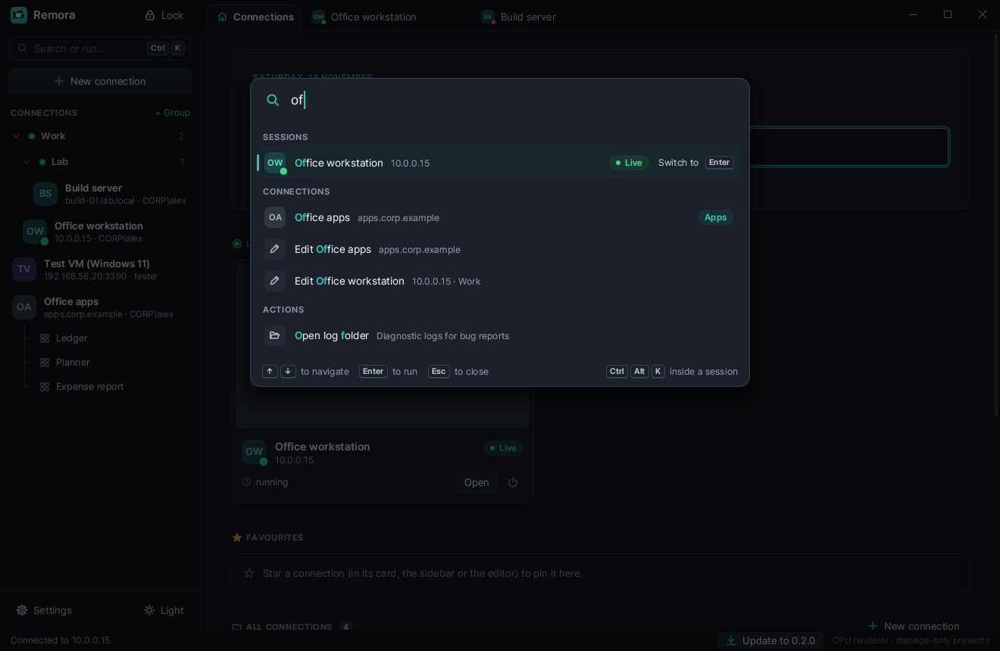

Inside a session, **Ctrl+Alt+K** opens it over the remote desktop with that
session's own commands first: disconnect, reconnect, full screen, each
sharing switch with its current state, shared folders, keyboard mode, fit to
window, recording and the panel.

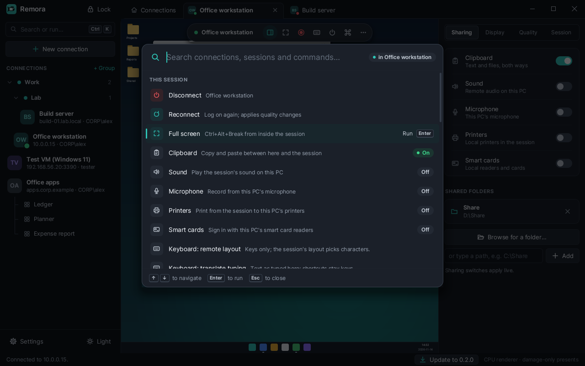

## Themes

**Dark** is the default. **Light** has the same layout. **System** follows the
Windows app theme and switches with it. Choose in **Settings**, under
**Appearance**, with the switch at the bottom of the sidebar, or in the
command palette.

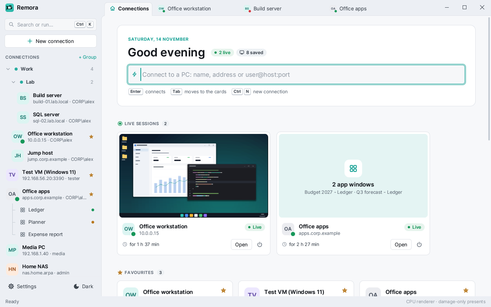

## The vault

Remora saves passwords only in an encrypted vault, protected by a master
password of at least 8 characters. Set it up in **Settings** under
**Security**, or switch on **Save password** in a connection.

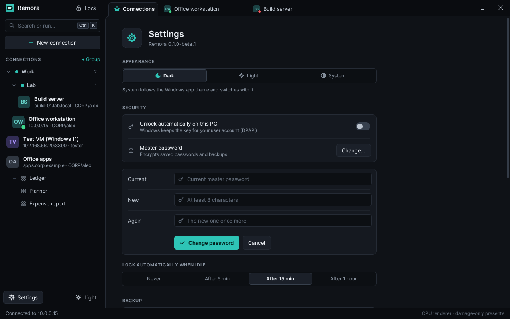

- **Lock automatically when idle**: never, after 5 minutes, 15 minutes (the
  default) or 1 hour.
- **Lock** at the top of the sidebar locks it at once. A locked Remora asks
  for the master password before it shows your connections.
- **Unlock automatically on this PC** lets Windows keep the key for your user
  account, so you are not asked.
- **Change…** sets a new master password.

How the vault is encrypted, and what is stored where, is in
[SECURITY.md](SECURITY.md).

## Backup and import

**Settings** has a **Backup** section.

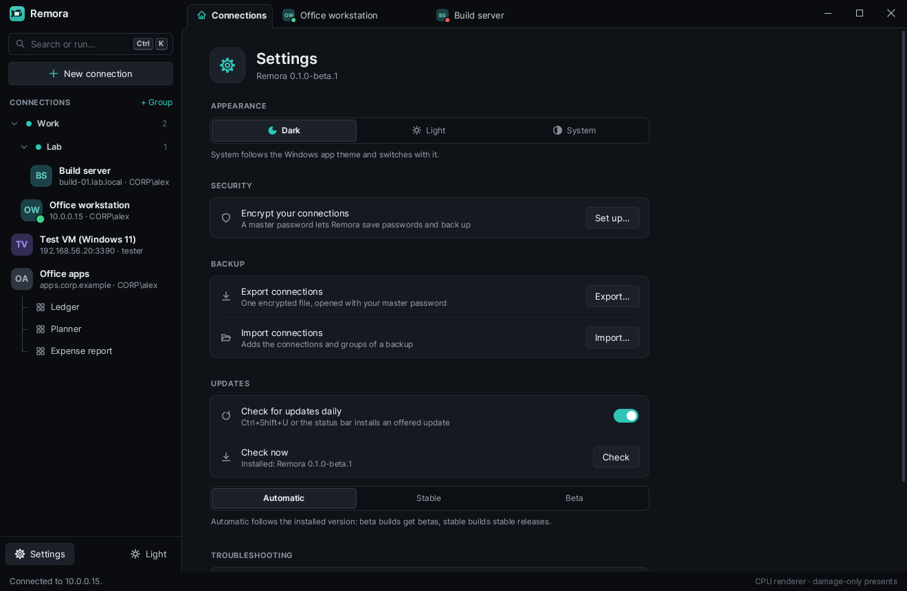

- **Export…** writes all connections and groups, with their saved passwords,
  to one `.rdpbackup` file encrypted with your master password. It needs a
  master password; set one up first under **Security**.
- **Import…** reads such a file, or the connections of
  [mRemoteNG](#from-mremoteng) and of
  [Remote Desktop Connection Manager](#from-remote-desktop-connection-manager-rdcman).
  Remora tells the kind of file from its content, not its name. The
  connections and groups are added to yours. Connections you already have
  (same name, host and group) are skipped.

The first start also offers **Import connections**.

After an import, a line says how many connections came over, and what did
not: connections that aren't RDP, ones you already had, and passwords that
could not be read, with the reason.

**Passwords come over only into the vault.** Without a master password,
Remora imports the connections without their passwords and says so: set up a
master password under **Security**, then import again. Connections you
already have are skipped, so a second import only adds what is missing; to
get passwords for those, delete them first.

### From a Remora backup

Type the master password the backup was made with. Everything comes over,
saved passwords included.

### From mRemoteNG

Pick `confCons.xml` (mRemoteNG keeps it in `%APPDATA%\mRemoteNG`). Files in
mRemoteNG's current formats (2.6 to 2.9) are read.

- **What comes over:** folders become groups; each RDP connection keeps its
  name, host, port, user and domain (as `DOMAIN\user`), password, RD Gateway
  (when set to Always or Detect), resolution (a fixed size, or fit to the tab
  for Fit to window, Smart size and Full screen), and clipboard, sound
  ("bring to this computer"), printers, smart cards and microphone.
  Inherited settings are resolved to the values the connection really uses.
  A connection that inherits its user and password from its folder inherits
  them from the group in Remora too.
- **SSH connections** (SSH1 and SSH2) come over as SSH connections with
  their host, port and user. Their passwords are left out and counted: ssh
  asks for them in the terminal.
- **What doesn't:** VNC, Telnet, HTTP and other connections are skipped and
  counted.
- **Passwords:** mRemoteNG encrypts them with AES-GCM and its master
  password. Remora tries mRemoteNG's built-in default first; only when the
  file is protected with your own master password does Import ask for it
  (**mRemoteNG master password**). A wrong password imports nothing.
  Files that also encrypt the whole file are read the same way.
  Passwords in files using another cipher (Serpent, Twofish, CCM or EAX), or
  in files older than format 2.6, cannot be read: those connections come over
  without them. Files from mRemoteNG's Windows protection (DPAPI) are read
  for the Windows user who saved them.

### From Remote Desktop Connection Manager (RDCMan)

Pick the `.rdg` file. Files from RDCMan 2.2 and from 2.7 to 2.93 are read.

- **What comes over:** the file becomes a group named after it, its groups
  become groups below it, and each server keeps its display name, host and
  port, logon credentials, gateway, remote desktop size (or fit to the tab
  for "same size as client area" and full screen), and clipboard, sound,
  printers, smart cards and microphone. Settings a server inherits from its
  group are resolved; a server that inherits its logon credentials inherits
  them from the group in Remora too. Credential profiles stored in the file
  are used. Smart groups and server references are skipped.
- **Passwords:** RDCMan encrypts them with Windows for the user who saved
  them. Import them on the same PC, signed in as the same Windows user;
  elsewhere they cannot be read and are counted. Passwords encrypted with a
  certificate, and credential profiles kept in RDCMan's own settings rather
  than in the file, cannot be read either: those connections come over with
  the rest of their settings.

## Updates

In **Settings**, under **Updates**:

- **Check for updates daily** (on by default) lets an installed copy ask
  GitHub once a day for a new release. **Check now** asks at once.
- Below it, choose the channel: **Automatic** follows the installed version
  (beta builds get betas, stable builds stable releases), or **Stable** or
  **Beta**.

When an update is ready, the status bar shows **Update to …**. Click it, or
press **Ctrl+Shift+U**, and Remora downloads the setup, checks it against the
release's `SHA256SUMS.txt`, closes, installs and starts again.

Portable copies do not check for updates; new versions are on the
[releases page](https://github.com/rennerdo30/rdp-rs/releases).

## The command line

`remora.exe` also connects from the command line, takes headless screenshots
and recordings, shadows sessions
([Shadowing and shared desktops](#shadowing-and-shared-desktops)), and prints a
protocol trace. `--legacy-security` allows the weak legacy RDP security for
that connection, as the Advanced switch does. See the
[README](../README.md#build-and-run).

- `--jump user@host[:port]` connects through an SSH jump host, with
  `--jump-key FILE` for its key file. A new jump host key is asked about on
  the console; `--expect-jump-fingerprint SHA256:...` pins it instead (for
  scripts: nothing asked, nothing remembered).
- `remora --ssh user@host[:port] [--ssh-key FILE] [--title NAME]` opens ssh
  in a terminal, as an SSH connection in the manager does.
